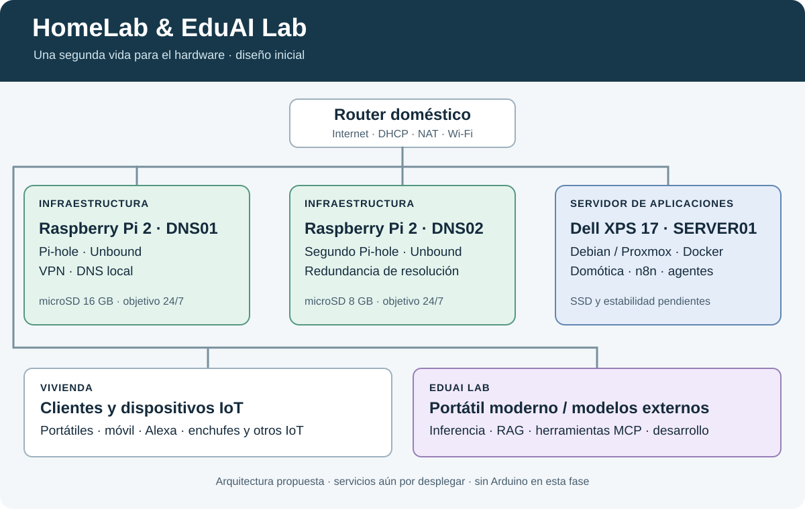
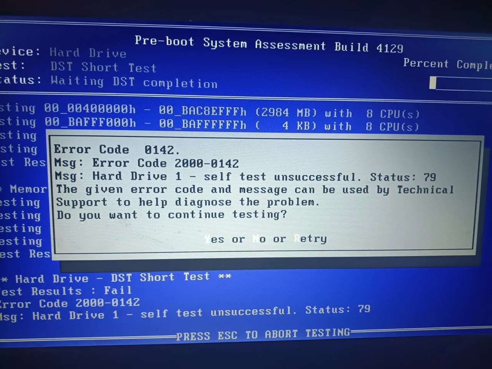
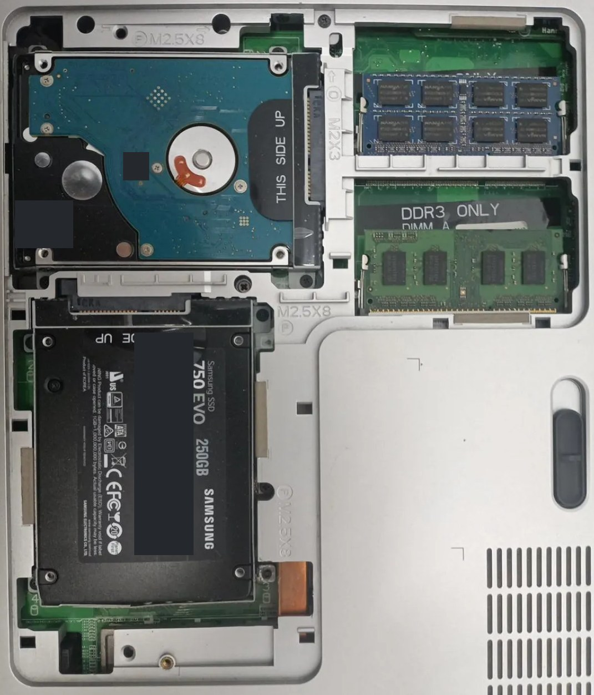
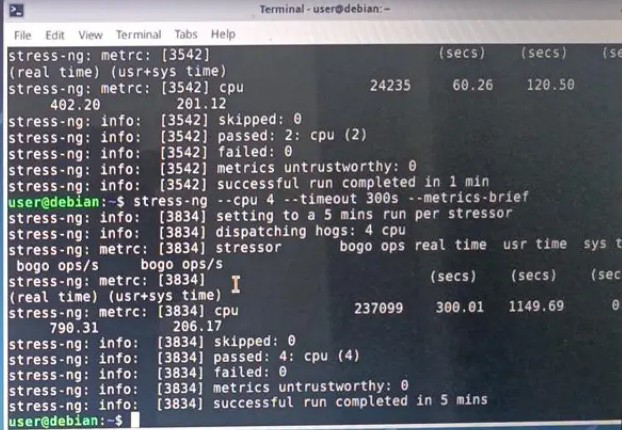

**¡La que se va a liar!** Lo que empezó siendo una conversación con ChatGPT sobre cómo instalar Pi-hole para quitarme algo de publicidad de encima ha acabado convirtiéndose en el diseño de un pequeño centro de datos doméstico. Y lo mejor es que buena parte del material llevaba años por casa, esperando una segunda oportunidad.

Mi idea inicial era bastante sencilla: aprovechar una Raspberry Pi, instalar un servidor DNS con filtrado de publicidad y, ya puestos, disponer de una VPN para acceder a mi red desde fuera. Pero una pregunta llevó a otra. ¿Y si centralizo la domótica? ¿Y si aprovecho la instalación fotovoltaica? ¿Y si monto un servidor de aplicaciones? ¿Y si, además, aprendo a desplegar inteligencia artificial y a construir mis propios agentes?

Como profesor de Formación Profesional de Informática, no pude evitar pensar en la cantidad de posibilidades que esto abría para el aula.

Así nace **HomeLab & EduAI Lab**, un proyecto personal que quiero ir construyendo, documentando y compartiendo por aquí. No tengo todavía una infraestructura terminada. Lo que tengo es algo casi igual de interesante: un punto de partida real, unos cuantos problemas que resolver y muchas ganas de experimentar.

*Diseño inicial: dos nodos de infraestructura, un servidor de aplicaciones y un equipo de experimentación con IA. Los servicios que aparecen son objetivos, no instalaciones ya operativas.*

## Todo empezó rebuscando por casa

La primera sorpresa fue descubrir que la Raspberry que recordaba como una Pi 4 era, en realidad, una Raspberry Pi 2 Model B. Poco después apareció una segunda unidad, esta vez con su carcasa y una tarjeta de 16 GB.

Y todavía quedaba otro equipo: un Dell XPS 17 L702X que compré en 2012. Un portátil que había quedado relegado al cajón y que, sobre el papel, seguía teniendo características interesantes para un pequeño servidor.

| Equipo | Qué tengo actualmente | Qué quiero explorar |
| --- | --- | --- |
| Raspberry Pi 2 nº 1 | 1 GB de RAM y microSD de 16 GB | DNS con Pi-hole, resolución recursiva y VPN |
| Raspberry Pi 2 nº 2 | 1 GB de RAM y microSD de 8 GB | Segundo servidor DNS y redundancia |
| Dell XPS 17 | Core i7-2670QM, 6 GB DDR3, dos unidades SATA | Linux, contenedores, virtualización y automatización |
| Portátil de uso habitual | Core i7-12700H | Desarrollo, administración y primeras pruebas de modelos de IA |

No se trata de tener el equipo más potente ni de comprar tecnología por comprar. Se trata de descubrir qué podemos conseguir con lo que ya tenemos y, cuando toque invertir, hacerlo sabiendo por qué.

## Primer problema: el Dell no arranca Windows

Al intentar recuperar el portátil me encontré con una pantalla con rayas naranjas y un cursor parpadeante. Mala pinta. Antes de darlo por perdido, lancé los diagnósticos de Dell y apareció el error `2000-0142`: fallo en la prueba interna de una unidad de almacenamiento.

*Primera incidencia real del proyecto: una unidad no supera su autodiagnóstico.*

En lugar de reinstalar Windows o formatear directamente, preparé un pendrive con Debian 13 Live. Desde ahí pude arrancar el equipo, conectarlo a la red y empezar a comprobar sus componentes sin instalar nada en los discos internos.

El diagnóstico SMART permitió identificar el principal sospechoso: el SSD Samsung 750 EVO de 250 GB. Aunque la evaluación general indicaba `PASSED`, su historial contenía errores de lectura no corregibles, bloques reasignados y una prueba corta fallida. El HDD Seagate de 750 GB, por su parte, no mostraba sectores pendientes ni reasignados, aunque acumula más de 21.000 horas de uso.

*El Dell abierto durante la inspección: dos discos SATA de 2,5 pulgadas y dos módulos de memoria accesibles. Se han ocultado identificadores de las unidades.*

También comprobé el procesador, parte de la memoria con `memtester`, el enlace Ethernet Gigabit y la disponibilidad de KVM. La gráfica integrada Intel funciona con Debian; la NVIDIA dedicada presenta errores con su controlador, pero no es necesaria para el papel de servidor que estoy planteando.

La prueba de CPU de cinco minutos terminó sin errores y he conseguido administrar el equipo por SSH desde mi portátil habitual. La última comprobación ha sido el arranque sin batería: funciona. Aun así, quedan pendientes una comprobación completa de la memoria, la refrigeración, el consumo eléctrico y la sustitución del SSD deteriorado.

*Una de las pruebas iniciales de estabilidad: cuatro procesos de carga durante cinco minutos, sin fallos. Aún falta comprobar las temperaturas máximas.*

Aquí hay una primera lección que me llevo al aula: **que un ordenador no arranque no significa necesariamente que el ordenador esté perdido**. Y que una herramienta indique `PASSED` tampoco significa que debamos dejar de investigar.

## De una red doméstica a un pequeño laboratorio

La propuesta inicial es mantener las Raspberry como infraestructura de bajo consumo, separando el DNS y el acceso remoto del servidor donde experimentaré con aplicaciones.

- **Infraestructura:** dos Pi-hole configurados de forma coherente, resolución recursiva con Unbound y acceso remoto privado. El router seguirá gestionando DHCP inicialmente. El objetivo es comprobar cómo se comportan los clientes cuando falla uno de los DNS.
- **Servidor de aplicaciones:** Debian con Docker Compose o Proxmox, según los recursos y la estabilidad del Dell. Aquí tendrán cabida Home Assistant, monitorización, almacenamiento, automatizaciones y entornos aislados de prácticas.
- **EduAI Lab:** modelos locales pequeños, APIs, asistentes documentales, agentes y herramientas MCP. El portátil moderno podrá aportar capacidad de inferencia cuando sea necesario; el Dell podrá orquestar tareas sin tener que ejecutar siempre el modelo.

La idea es que, si apago el servidor de aplicaciones o rompo algo durante una práctica, la vivienda no se quede sin resolución DNS por ese motivo. Eso no elimina otros puntos de fallo, como el router o la alimentación eléctrica, pero nos permite empezar a pensar en disponibilidad de una forma más realista.

## ¿Y qué tiene que ver todo esto con ASIR?

Cuanto más avanzaba la conversación, más me daba cuenta de que este proyecto permite trabajar buena parte de los contenidos del ciclo de Administración de Sistemas Informáticos en Red. No sustituye sus módulos ni pretende cubrir todo el currículo, pero sí puede convertirse en un escenario integrador que conecte conceptos que muchas veces estudiamos por separado.

| Área de aprendizaje | Aplicación en el HomeLab |
| --- | --- |
| Implantación y administración de sistemas operativos | Linux, usuarios, permisos, servicios, procesos, arranque y virtualización |
| Planificación y administración de redes | Direccionamiento, Ethernet, subredes, routing y futura segmentación mediante VLAN |
| Servicios en Red e Internet | DNS, DHCP, HTTP, HTTPS, SSH, VPN y disponibilidad |
| Fundamentos de hardware | Inventario, SMART, memoria, refrigeración, almacenamiento y consumo |
| Seguridad y alta disponibilidad | Mínimo privilegio, aislamiento, filtrado, copias, restauración y pruebas de caída |
| Bases de datos y administración de SGBD | PostgreSQL, MariaDB, almacenamiento persistente y bases vectoriales |
| Implantación de aplicaciones web | Docker Compose, APIs REST, PHP, Python y publicación de servicios |
| Lenguajes de marcas y documentación | Markdown, YAML, JSON, Git y documentación reproducible |
| Proyecto intermodular | Requisitos, arquitectura, presupuesto, pruebas, decisiones y documentación |

También hay muchas posibilidades para SMR: montaje y mantenimiento, sistemas operativos, redes locales, servicios de red, seguridad y aplicaciones web, ajustando la profundidad y el grado de autonomía.

Y eso me gusta especialmente: poder llevar al aula los mismos problemas que aparecen cuando intentas construir una infraestructura de verdad. No solo enseñar comandos, sino aprender a decidir qué hacer cuando esos comandos no devuelven el resultado esperado.

## La parte que más curiosidad me despierta: la IA y los agentes

Hasta ahora he utilizado la inteligencia artificial principalmente como herramienta de apoyo. Con este proyecto quiero dar un paso más: comprender cómo se despliegan los modelos, cómo se integran en aplicaciones y cómo se construyen sistemas que utilizan herramientas para realizar tareas.

Me interesa aprender a montar una IA local, evaluar modelos cuantizados, crear un asistente que consulte mis propios apuntes mediante RAG, diseñar automatizaciones con n8n y desarrollar herramientas mediante MCP (Model Context Protocol).

Algunas ideas concretas que me gustaría llevar a la práctica:

- Un asistente que detecte enlaces rotos o inconsistencias en este portafolio y proponga correcciones para revisar antes de publicar.
- Un tutor de DNS y DHCP que consulte los materiales de SRI o SER sin acceder a las soluciones privadas del profesorado.
- Un flujo que analice registros de los servidores, explique incidencias y sugiera comprobaciones, sin modificar automáticamente la infraestructura.
- Un asistente que interprete datos de consumo energético y proponga mejoras de autoconsumo, mientras las automatizaciones físicas siguen reglas verificadas.

No necesito entrenar un modelo desde cero ni comprar una GPU de inmediato. Primero quiero conocer los límites del hardware disponible, distinguir entre inferencia, recuperación documental y automatización, y medir qué aporta cada tecnología.

## Lo que viene ahora

Esto es solo el comienzo. Quiero convertirlo en una serie de entradas en la que documente tanto los aciertos como los problemas, con configuraciones reproducibles, resultados reales y decisiones razonadas.

Los próximos pasos serán recuperar el almacenamiento del Dell, comprobar si merece la pena ampliar la memoria, poner en marcha las dos Raspberry y validar el DNS antes de modificar la configuración general de la vivienda. Después vendrán los servicios de aplicaciones, la domótica, la monitorización y las primeras pruebas de IA.

Más adelante me gustaría trasladar parte de lo aprendido a prácticas de clase y compartir también el proceso en LinkedIn.

De momento, tengo dos Raspberry que necesitan alimentación, un portátil de 2012 que ha vuelto a arrancar y un proyecto que no para de crecer.

**Y pensar que todo empezó porque quería quitar la publicidad de casa…**
