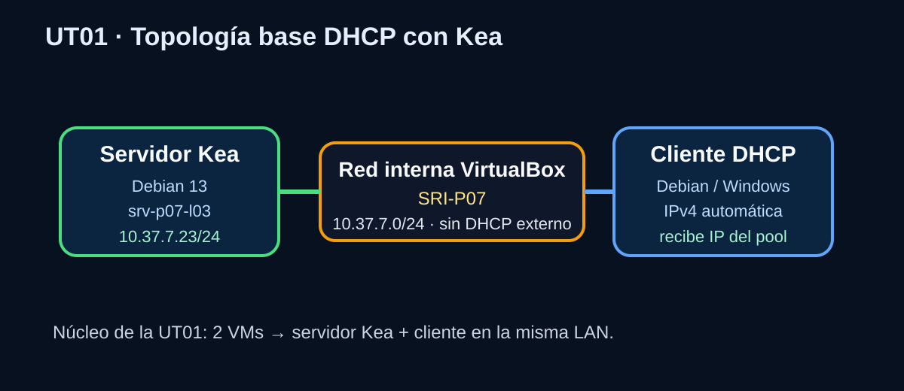
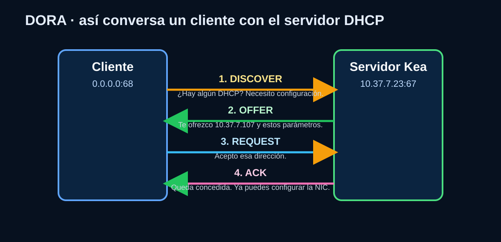
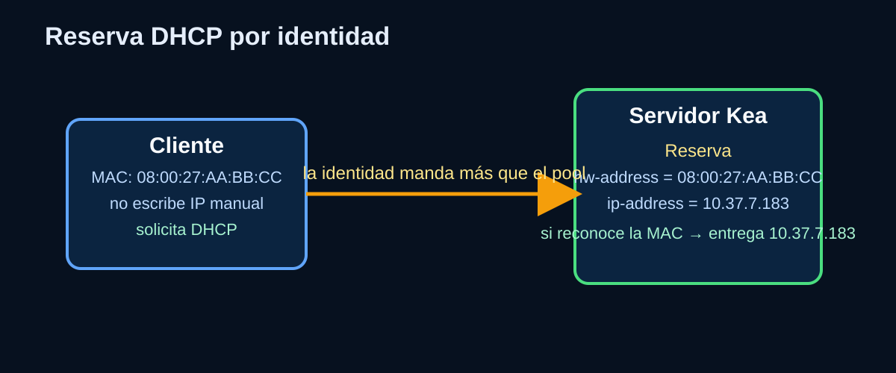
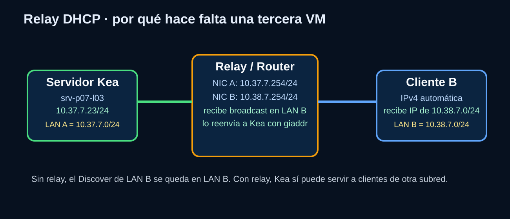
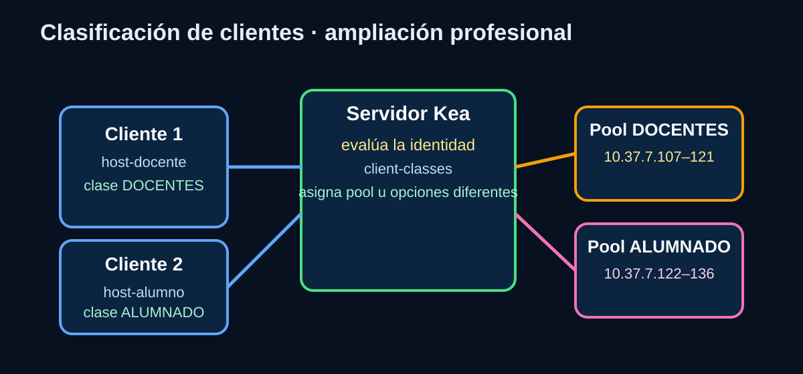
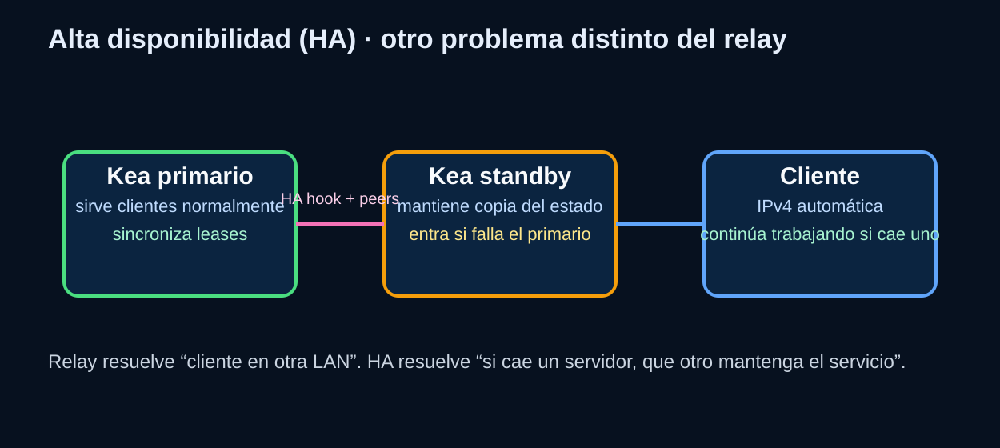

---

title: "UT01 · Configuración automática profesional: DHCP con Kea"

description: "Diseño, implantación, observación y diagnóstico de DHCPv4 con Kea en Debian 13: DORA, pool, reservas, relay, clasificación de clientes y alta disponibilidad."

summary: "Laboratorio guiado de DHCP con Kea para 2.º ASIR: desde el escenario mínimo funcional hasta relay, clases y HA."

module_key: sri

cycle_key: asir

order: 1

module_title: Servicios de Red e Internet

module_code: '0375'

cycle_title: Administración de Sistemas Informáticos en Red

course: 2.º ASIR

unit: UT01

hours: 12

level: intermedio

authors:

- fjcano

reviewers:

- fjcano

rights: all-rights-reserved

version: '3.3'

last_reviewed: '2026-11-19'

visibility: public

ra:

- RA2

ce:

- RA2.a
- RA2.b
- RA2.c
- RA2.d
- RA2.e
- RA2.f
- RA2.g

tags:

- dhcp
- kea
- debian
- dora
- relay
- reservas
- clasificacion
- ha
- diagnostico

permalink: /docencia/asir/sri/ut01/

published: true

toc:

- title: Misión y ruta de aprendizaje

  id: mision

- title: Infraestructura y prerrequisitos

  id: prerrequisitos

- title: Individualización

  id: individualizacion

- title: Qué es DHCP y qué es DORA

  id: dora

- title: Instalación de Kea

  id: instalacion

- title: Configuración mínima funcional

  id: minima

- title: Validación y evidencias

  id: validacion

- title: Reserva DHCP por identidad

  id: reservas

- title: Relay básico

  id: relay

- title: Diagnóstico guiado

  id: diagnostico

- title: Clasificación de clientes

  id: clases

- title: Alta disponibilidad (HA)

  id: ha

- title: Equivalencias ISC/Kea

  id: equivalencias

- title: Cierre y Moodle

  id: cierre

---

## Misión y ruta de aprendizaje {#mision}

> **Secuencia de SRI.** De la IP fija en UT00 pasamos a DHCP con Kea en Debian 13. En UT02 trabajaremos la resolución de nombres con DNS.

**Resultado de aprendizaje (RA2).** Administra servicios de configuración automática, identificándolos y verificando la correcta asignación de los parámetros.

**Misión.** Transformar el laboratorio estático de UT00 en una infraestructura donde los clientes reciban **configuración IPv4 automática** mediante **Kea DHCPv4**, y donde podamos demostrar qué ha ocurrido mediante **DORA, leases, logs y pruebas cliente-servidor**.

> **Idea clave de esta unidad:** No se trata de “copiar un JSON”. Se trata de entender **qué problema resuelve DHCP**, **qué hace el servidor**, **qué ve el cliente** y **cómo demuestras que funciona**.

### Ruta de aprendizaje recomendada

1. **Núcleo obligatorio**: Kea básico en una sola LAN con **2 VMs**.
2. **Reserva DHCP**: el servidor reconoce a un cliente y le da siempre la misma IP.
3. **Relay**: un cliente de otra LAN necesita una tercera VM porque los broadcasts DHCP no atraviesan un router normal.
4. **Clases de clientes**: distintas políticas para distintos grupos.
5. **HA**: continuidad del servicio cuando un servidor falla.



---

## Infraestructura y prerrequisitos {#prerrequisitos}

### Escenario mínimo obligatorio

- **VM 1**: Debian 13 servidor con Kea.
- **VM 2**: cliente Debian o Windows con IPv4 automática.
- **Red interna VirtualBox**: `SRI-Pxx`.
- **Snapshot recomendado al empezar**: `UT01_ANTES_KEA`.

### Escenario ampliado para relay

- **VM 1**: Kea.
- **VM 2**: relay/router con **dos NIC internas**.
- **VM 3**: cliente de LAN B.

### Escenario ampliado para HA

- **VM 1**: Kea primario.
- **VM 2**: Kea standby.
- **VM 3**: cliente.

### Lo que debes dominar antes

Antes de continuar comprueba que en **UT00** ya sabes:

- identificar la NIC de la red interna;
- configurar IP fija en Debian;
- distinguir NAT de Red Interna;
- usar `ip -br address`, `ip route`, `ping`, `ss` y `journalctl`.

---

## Individualización {#individualizacion}

Cada alumno trabaja con valores propios.

- `P`: número de puesto (`01–40`).
- `L`: inicial normalizada del primer apellido (`A=01 … Z=26`).

| Dato | Fórmula | Ejemplo `P07-L03` |
|---|---|---|
| Red LAN A | `10.37.P.0/24` | `10.37.7.0/24` |
| Servidor Kea | `10.37.P.(20+L)` | `10.37.7.23` |
| Pool dinámico | `10.37.P.(100+P)` a `10.37.P.(129+P)` | `10.37.7.107` a `10.37.7.136` |
| Reserva DHCP | `10.37.P.(180+L)` | `10.37.7.183` |
| Duración de concesión | `1800+60×L` segundos | `1980 s` |
| T1 · Renovación | `floor(valid/2)` | `990 s` |
| T2 · Rebinding | `floor(valid×7/8)` | `1732 s` |
| Red LAN B (ampliación) | `10.38.P.0/24` | `10.38.7.0/24` |
| Relay · NIC A | `10.37.P.254` | `10.37.7.254` |
| Relay · NIC B | `10.38.P.254` | `10.38.7.254` |

### ¿Qué significa esto en lenguaje sencillo?

- El **servidor** tiene una IP fija.
- El **cliente** no la escribe a mano: la recibe por DHCP.
- El **pool** es el conjunto de IPs dinámicas que Kea puede entregar.
- La **reserva** sirve para que un cliente concreto reciba siempre la misma IP.

---

## Qué es DHCP y qué es DORA {#dora}

### ¿Qué problema resuelve DHCP?

Si tuviéramos 25 ordenadores, configurarlos a mano sería lento, propenso a errores y difícil de mantener.

DHCP permite que los clientes reciban automáticamente:

- dirección IP,
- máscara,
- puerta de enlace,
- DNS,
- tiempo de concesión.

### DORA explicado para principiantes

DHCPv4 suele resumirse como **DORA**:

1. **Discover** → el cliente pregunta “¿hay algún servidor DHCP?”.
2. **Offer** → el servidor responde “te ofrezco esta IP”.
3. **Request** → el cliente contesta “acepto esa IP”.
4. **ACK** → el servidor confirma “queda concedida”.



### ¿Qué debes saber observar?

- **qué IP ofrece** el servidor;
- **qué servidor** ha respondido;
- **cuánto dura** la concesión;
- **qué parámetros** recibe el cliente.

---

## Instalación de Kea {#instalacion}

> Vamos a empezar el proceso de creación del laboratorio, por lo tanto, sigue los pasos en orden y **comprueba el resultado de cada bloque antes de pasar al siguiente**.

### Paso 1 · comprobar la IP fija del servidor

En el servidor Debian:

```bash
ip -br address
ip route
hostnamectl
```

**Resultado esperado** para el ejemplo:

- `10.37.7.23/24` en la NIC interna;
- hostname del tipo `srv-p07-l03`.

### Paso 2 · actualizar paquetes

```bash
sudo apt update
```

### Paso 3 · instalar Kea DHCPv4

```bash
sudo apt install kea-dhcp4-server -y
```

### Paso 4 · localizar el fichero de configuración

En Debian 13 el fichero habitual es:

```text
/etc/kea/kea-dhcp4.conf
```

### Paso 5 · hacer copia de seguridad

```bash
sudo cp /etc/kea/kea-dhcp4.conf /etc/kea/kea-dhcp4.conf.bak-ut01
```

---

## Configuración mínima funcional {#minima}

### Objetivo de esta fase

Conseguir que **un cliente en la misma LAN** reciba una IP del pool.

### Paso 1 · editar el fichero

```bash
sudo nano /etc/kea/kea-dhcp4.conf
```

### Paso 2 · pegar una configuración mínima completa

> Sustituye el contenido por un fichero equivalente a este ejemplo `P07-L03`. **No anunciamos gateway en LAN A** porque en la fase básica no hay router interno; los servidores DNS se configurarán en UT02. `domain-name` comunica un nombre de dominio, **no** proporciona servidores DNS ni hace que el cliente tenga Internet.

```json
{
  "Dhcp4": {
    "interfaces-config": {
      "interfaces": [ "enp0s8" ]
    },
    "lease-database": {
      "type": "memfile",
      "name": "/var/lib/kea/kea-leases4.csv",
      "persist": true
    },
    "renew-timer": 990,
    "rebind-timer": 1732,
    "valid-lifetime": 1980,
    "subnet4": [
      {
        "id": 1,
        "subnet": "10.37.7.0/24",
        "pools": [
          { "pool": "10.37.7.107 - 10.37.7.136" }
        ],
        "option-data": [
          { "name": "domain-name", "data": "p07-l03.sri.test" }
        ]
      }
    ],
    "loggers": [
      {
        "name": "kea-dhcp4",
        "severity": "INFO"
      }
    ]
  }
}
```

### Paso 3 · ¿qué significa cada parte?

| Bloque de Kea | Significado |
|---|---|
| `interfaces-config` | Indica en qué interfaces de red debe atender Kea las solicitudes DHCP. |
| `lease-database` | Define cómo y dónde se almacenan las concesiones DHCP (**leases**). |
| `valid-lifetime` | Establece la duración de una concesión DHCP. |
| `renew-timer` | Establece T1: momento en el que el cliente comienza a intentar renovar su concesión. |
| `rebind-timer` | Establece T2: momento en el que el cliente intenta renovar con cualquier servidor DHCP disponible. |
| `subnet4` | Define las subredes IPv4 que administra el servidor. |
| `pools` | Define los rangos de direcciones IP que pueden asignarse dinámicamente dentro de una subred. |
| `option-data` | Define parámetros adicionales que se entregarán al cliente, como puerta de enlace, DNS o dominio. |
| `reservations` | Permite asignar una dirección IP concreta a un cliente identificado, por ejemplo, mediante su MAC. |

### Paso 4 · validar la sintaxis

En nuestro escenario de laboratorio se recomienda validar con el usuario del servicio `_kea`, lo que permite reproducir los permisos efectivos de lectura del fichero. Si ese usuario no existe en tu instalación, comprueba la cuenta declarada en la unidad systemd.

```bash
sudo -u _kea /usr/sbin/kea-dhcp4 -t /etc/kea/kea-dhcp4.conf
```

**Si sale bien**, el comando termina sin errores.

### Paso 5 · reiniciar el servicio

```bash
sudo systemctl restart kea-dhcp4-server
sudo systemctl status kea-dhcp4-server --no-pager
```

### Paso 6 · comprobar logs

```bash
sudo journalctl -u kea-dhcp4-server -n 50 --no-pager
```

### Paso 7 · preparar el cliente

En el cliente:

- dejar la NIC de la red interna en **IPv4 automática**;
- si tenía IP estática en UT00, quitarla.

En un cliente Linux mínimo, primero identifica qué gestiona su NIC: no presupongas que está instalado `dhclient`. Comprueba los dos posibles clientes DHCP y abre la configuración **del cliente, no del servidor**:

```bash
ip -br link
command -v dhcpcd
command -v dhclient
sudo nano /etc/network/interfaces
```

**Solo si esta NIC la gestiona `ifupdown`**, configura su interfaz de red interna como sigue, reemplazando `NIC_CLIENTE` por el nombre real y sin alterar el adaptador NAT:

```text
allow-hotplug NIC_CLIENTE
iface NIC_CLIENTE inet dhcp
```

Guarda el fichero y, desde la **consola local de la VM**, reinicia solo esa interfaz (si lo haces por SSH podrías perder la conexión):

```bash
command -v dhcpcd
command -v dhclient
# Para ifupdown (sustituye el nombre real de NIC):
sudo ifdown NIC_CLIENTE && sudo ifup NIC_CLIENTE
```

En Windows:

```powershell
ipconfig /release
ipconfig /renew
ipconfig /all
```

---

## Validación y evidencias {#validacion}

### Qué debe ocurrir

Para P07-L03, el cliente no reservado debe recibir una IP del pool `10.37.7.107 – 10.37.7.136`; para otros puestos, calcula el rango con su tabla de individualización.

### Qué debes comprobar

En el cliente:

```bash
ip -br address
ip route
```

En Windows:

```powershell
ipconfig /all
```

En el servidor:

```bash
sudo cat /var/lib/kea/kea-leases4.csv
```

### Evidencias mínimas de la fase básica

1. captura de la configuración del cliente;
2. línea correspondiente en `kea-leases4.csv`;
3. extracto del log de Kea;
4. explicación breve de DORA.

---

## Reserva DHCP por identidad {#reservas}

### Objetivo

Que **un cliente concreto** reciba siempre la misma IP: `10.37.7.183` en el ejemplo P07-L03; calcula la de tu variante.

### Concepto en lenguaje sencillo

El servidor no “adivina” quién es el cliente. Necesita una **identidad**.

La más habitual en nuestras prácticas es la **MAC** (`hw-address`); comprueba que sea la de la NIC interna, no la de NAT. El cliente también puede enviar un identificador DHCP propio (`client-id`); si conserva un lease anterior, puede ser necesario liberar o renovar la concesión antes de comprobar la reserva.



### Paso 1 · averiguar la MAC del cliente

En Linux:

```bash
ip link
```

En Windows:

```powershell
ipconfig /all
```

Apunta la MAC de la NIC conectada a `SRI-Pxx`.

### Paso 2 · editar la configuración de Kea

Dentro del objeto **de tu subred** dentro de `subnet4`, añade el bloque `reservations`. El fragmento siguiente es **solo una propiedad JSON**, no sustituye el fichero entero. Coloca una coma tras la propiedad anterior cuando sea necesario:

```json
"reservations": [
  {
    "hw-address": "08:00:27:AA:BB:CC",
    "ip-address": "10.37.7.183"
  }
]
```

### Paso 3 · validar y reiniciar

```bash
sudo -u _kea /usr/sbin/kea-dhcp4 -t /etc/kea/kea-dhcp4.conf
sudo systemctl restart kea-dhcp4-server
```

### Paso 4 · forzar la renovación en el cliente

Linux:

```bash
command -v dhcpcd
command -v dhclient
# Para ifupdown (sustituye el nombre real de NIC):
sudo ifdown NIC_CLIENTE && sudo ifup NIC_CLIENTE
```

Windows:

```powershell
ipconfig /release
ipconfig /renew
```

### Resultado esperado

El cliente reservado del ejemplo recibe **10.37.7.183**, aunque el pool normal sea `107–136`. En tu puesto, comprueba la IP calculada.

### Idea importante

La **reserva** es una decisión más específica que el **pool**.

Si Kea reconoce a ese cliente, le entrega la IP reservada.

---

## Relay básico {#relay}

### ¿Qué problema resuelve?

En la fase básica, servidor y cliente están en la **misma LAN**.

Pero si el cliente está en **otra subred**, su `DHCPDISCOVER` inicial es **broadcast** y **no atraviesa un router normal**.

Aquí entra en juego el **relay**.

> **¿Qué es un relay?**

> Es un intermediario, es decir, escucha la petición broadcast del cliente en LAN B y la reenvía al servidor Kea de LAN A.



### ¿Por qué hace falta una tercera VM?

Porque ahora ya no basta con “servidor + cliente”:

- una VM será el **servidor Kea**;
- otra VM será el **relay/router** con **dos NIC internas**;
- otra VM será el **cliente de LAN B**.

### Topología

```text
LAN A 10.37.7.0/24                         LAN B 10.38.7.0/24
Kea 10.37.7.23 ── Relay (10.37.7.254 | 10.38.7.254) ── Cliente DHCP
```

### Paso 1 · preparar la VM relay/router

La VM relay necesita:

- **NIC A** en `SRI-Pxx`;
- **NIC B** en otra Red Interna (por ejemplo `SRI-Pxx-B`).

Configura IP fija en ambas NIC:

- `10.37.7.254/24` en la NIC A;
- `10.38.7.254/24` en la NIC B.

### Paso 2 · instalar el servicio relay

En Debian:

```bash
sudo apt update
sudo apt install isc-dhcp-relay -y
```

### Paso 3 · configurar el relay

El paquete `isc-dhcp-relay` sigue disponible en Debian 13, aunque está marcado como obsoleto; se utiliza aquí únicamente para practicar el concepto de relay; el **servidor** continúa siendo Kea. Edita:

```bash
sudo nano /etc/default/isc-dhcp-relay
```

Ejemplo:

```text
SERVERS="10.37.7.23"
INTERFACES="NIC_LAN_A NIC_LAN_B"
OPTIONS=""
```

- `SERVERS`: IP del servidor Kea.
- `INTERFACES`: sustituye por los nombres reales de las dos NIC del relay; no copies nombres de otra VM.

### Paso 4 · reiniciar y comprobar

```bash
sudo systemctl restart isc-dhcp-relay
sudo systemctl status isc-dhcp-relay --no-pager
```

### Paso 5 · añadir la nueva subred en Kea

En `/etc/kea/kea-dhcp4.conf`, dentro de la lista `subnet4`, conserva el primer objeto de LAN A, añade una coma después de su llave de cierre e inserta el siguiente objeto antes del `]` que cierra la lista. Guarda, ejecuta `sudo -u _kea /usr/sbin/kea-dhcp4 -t /etc/kea/kea-dhcp4.conf` y, si valida, `sudo systemctl restart kea-dhcp4-server`.

```json
{
  "id": 2,
  "subnet": "10.38.7.0/24",
  "pools": [
    { "pool": "10.38.7.107 - 10.38.7.136" }
  ],
  "option-data": [
    { "name": "routers", "data": "10.38.7.254" },
    { "name": "domain-name", "data": "p07-l03.sri.test" }
  ]
}
```

### Paso 6 · ruta de retorno desde Kea y reenvío del relay

En Kea debe existir ruta a LAN B a través de la IP del relay en LAN A. Para P07-L03:

```bash
sudo ip route add 10.38.7.0/24 via 10.37.7.254
ip route get 10.38.7.120
```

Si ya existe una ruta hacia LAN B, no añadas una duplicada; revisa antes `ip route`. La orden anterior es **temporal**: para conservarla tras reiniciar, incorpórala al gestor de red que utilice tu Debian. Si el relay también actúa como router de los clientes de LAN B, activa el reenvío IPv4 en esa VM (`net.ipv4.ip_forward=1`) y anuncia `.254` como gateway **solo cuando exista ese router**.

### Paso 7 · cliente de LAN B

Crea o reutiliza una VM cliente conectada a la red interna de LAN B (`SRI-Pxx-B`) y deja su IPv4 en automático.

### Paso 8 · renovar la configuración del cliente B

Linux:

```bash
command -v dhcpcd
command -v dhclient
# Para ifupdown (sustituye el nombre real de NIC):
sudo ifdown NIC_CLIENTE && sudo ifup NIC_CLIENTE
```

### Resultado esperado

El cliente B recibe una IP del **pool B** (`10.38.7.107–136` en el ejemplo), y podemos identificar la selección por `giaddr` en la captura. Si solo recibe `10.38.7.x`, eso por sí solo no demuestra qué DHCP respondió.

### ¿Qué significa `giaddr`?

Cuando el relay reenvía la petición, Kea puede saber **desde qué subred llegó**.

Ese dato ayuda a seleccionar la subred correcta.

---

## Diagnóstico guiado {#diagnostico}

Cuando algo falle, no improvises. Sigue este orden.

### 1. ¿Está vivo el servicio?

```bash
sudo systemctl status kea-dhcp4-server --no-pager
```

### 2. ¿La configuración tiene errores?

```bash
sudo -u _kea /usr/sbin/kea-dhcp4 -t /etc/kea/kea-dhcp4.conf
```

### 3. ¿Kea está atendiendo la interfaz y ofreciendo concesiones?

```bash
sudo journalctl -u kea-dhcp4-server -b --no-pager -n 80
```

`ss -lunp | grep ':67'` puede servir como pista auxiliar, **pero no es prueba concluyente de Kea**: en Linux puede usar **raw sockets**. La prueba completa es configuración válida, logs, tráfico DORA y lease.

### 4. ¿Llega Discover y sale Offer?

```bash
sudo tcpdump -ni NIC_LAN 'udp port 67 or udp port 68'
```

### 5. ¿El cliente está realmente en IPv4 automática?

Compruébalo en la VM cliente.

### 6. ¿La red interna coincide en VirtualBox?

Confirma que servidor y cliente están en la **misma Red Interna** cuando trabajas el núcleo básico.

### 7. Si es relay, ¿el servicio relay está levantado?

```bash
sudo systemctl status isc-dhcp-relay --no-pager
```

### Errores típicos

| Síntoma | Posibles causas o comprobaciones |
|---|---|
| El cliente no recibe ninguna IP | Kea detenido, NIC incorrecta, cliente conectado a otra red interna, pool mal configurado o agotado. |
| El test `kea-dhcp4 -t` falla | Revisar sintaxis, fichero, permisos y mensaje de error. No asumir que siempre es un problema de JSON. |
| El cliente recibe una IP del pool en lugar de la reservada | MAC o identificador de cliente incorrecto, reserva mal ubicada o concesión anterior todavía vigente. |
| El cliente de LAN B no recibe IP | Relay mal configurado, segunda subred ausente en Kea, interfaces incorrectas o falta de ruta de retorno. |
| Kea aparece activo, pero el cliente no recibe una concesión | Revisar logs, configuración de la interfaz, tráfico DORA y correspondencia entre subred y pool. |
| `ss` no muestra UDP/67 | No concluir que Kea está detenido: puede utilizar sockets RAW. Comprobar servicio, logs y tráfico DHCP real. |
| El cliente recibe IP, pero no tiene Internet | Revisar si se ha anunciado una puerta de enlace, si existe realmente un router y si hay conectividad hacia el exterior. |

---

## Clasificación de clientes {#clases}

### ¿Qué significa clasificar clientes?

Significa que **no todos los clientes tienen por qué recibir la misma política**.

Ejemplo didáctico:

- los equipos **DOCENTES** reciben direcciones de un pool;
- los equipos **ALUMNADO** reciben direcciones de otro.



### ¿Hay que aprender esto ya de memoria?

**No.**

Primero debes dominar:

- pool único,
- reserva,
- cliente funcional,
- logs,
- relay básico.

### Ejemplo para razonar

Supongamos dos clases:

- `DOCENTES` → `10.37.7.107 – 10.37.7.121`
- `ALUMNADO` → `10.37.7.122 – 10.37.7.136`

La lógica de clasificación puede apoyarse en reservas, expresiones o atributos del cliente, y Kea permite usar clases para influir en selección de subred, pool u opciones. La clasificación se puede aplicar, entre otras cosas, a selección de subred y de pool ([manual oficial de Kea](https://kea.readthedocs.io/)).

### Qué debe quedar claro al alumno

- clasificar **no es lo mismo** que reservar;
- clasificar sirve para aplicar una **política por grupos**;
- es una **ampliación profesional**, no el núcleo mínimo para aprobar la práctica básica.

---

## Alta disponibilidad con Kea {#ha}

**Práctica final.** Vas a demostrar que dos servidores comparten concesiones y que el cliente puede obtener una respuesta DHCP nueva durante una caída. Trabaja desde las consolas de VirtualBox. El ejemplo web usa **P07-L03**. Si seguiste el guion en PDF **P21-L03**, tus servidores son `10.37.21.23` y `10.37.21.24`. Calcula red, pool y tiempos con la tabla de individualización antes de copiar los ejemplos.



### 1. Prepara tres máquinas

| Máquina | Adaptador interno en SRI-P07 | Función |
|---|---|---|
| server1 | 10.37.7.23/24 | Primario que ya funcionaba en la práctica básica |
| server2 | 10.37.7.24/24 | Debian 13 independiente, en espera |
| Cliente | IPv4 automática | Genera solicitudes y permite identificar al servidor que responde |

Para otro puesto, asigna al standby la IP del primario más uno y comprueba que está libre. Apaga el relay y devuelve el cliente de LAN B a LAN A. En **VirtualBox → máquina apagada → Configuración → Red**, conecta los tres adaptadores de laboratorio a la misma **Red interna**. Usa NAT en los servidores únicamente para instalar paquetes. En el cliente deja solo la NIC interna. Este ejercicio usa HTTP de control exclusivamente dentro de esta red aislada de tres VM.

Parte de la instantánea con el pool básico funcionando. Crea una instantánea antes de HA. Prepara server2 con la ruta de IP fija de UT00. Si clonas una VM, genera MAC nuevas en VirtualBox y cambia la IP desde consola con el cable interno desconectado antes de conectarla. Evita arrancar una copia del servicio DHCP independiente en la LAN activa.

En **ambos servidores**, instala los paquetes y detén DHCP mientras preparas la pareja. Mantén el cliente apagado.

```bash
sudo apt update
sudo apt install kea-dhcp4-server kea-ctrl-agent curl jq tcpdump
sudo systemctl stop kea-dhcp4-server
ip -br -4 addr
timedatectl status
/usr/sbin/kea-dhcp4 -v
dpkg -L kea-common | grep -E 'libdhcp_(ha|lease_cmds)\.so$'
sudo cp -a /etc/kea/kea-dhcp4.conf /etc/kea/kea-dhcp4.conf.pre-ha
sudo cp -a /etc/kea/kea-ctrl-agent.conf /etc/kea/kea-ctrl-agent.conf.pre-ha
```

Busca Kea **2.6.x**, las dos bibliotecas y la NIC con la IP interna de cada nodo. Desde server1 haz `ping -c 3 10.37.7.24` y desde server2 `ping -c 3 10.37.7.23`. Continúa cuando ambos reciban respuesta y los relojes coincidan. Conserva las copias iniciales si repites el ejercicio.

### 2. Configura el agente de control en cada nodo

El otro servidor envía peticiones HTTP al agente. El agente las entrega al proceso DHCPv4 local por un socket UNIX. Abre `sudo nano /etc/kea/kea-ctrl-agent.conf`. Este es el fichero completo de **server1**. En **server2** usa el mismo texto cambiando `http-host` a `10.37.7.24`. Guarda con **Ctrl+O**, **Intro**, **Ctrl+X**.

```json
{
  "Control-agent": {
    "http-host": "10.37.7.23",
    "http-port": 8000,
    "control-sockets": {
      "dhcp4": {
        "socket-type": "unix",
        "socket-name": "kea-dhcp4-ctrl.sock"
      }
    }
  }
}
```

### 3. Configura DHCPv4 en ambos servidores

Abre `sudo nano /etc/kea/kea-dhcp4.conf`. Ejemplo **completo para server1**, Debian 13 amd64. Adapta la NIC y las rutas de bibliotecas a los resultados del paso 1. Para **server2**, copia el mismo documento y cambia **solo** el valor de `this-server-name` a `server2`, además del nombre de la NIC si difiere. Conserva el orden y los roles de la lista `peers` en ambos. Si reutilizas reservas u opciones de otro ejercicio, incorpóralas a los dos ficheros. HA replica las concesiones, mientras que el administrador mantiene las configuraciones.

```json
{
  "Dhcp4": {
    "interfaces-config": {
      "interfaces": [
        "enp0s8"
      ]
    },
    "lease-database": {
      "type": "memfile",
      "name": "/var/lib/kea/kea-leases4.csv",
      "persist": true
    },
    "renew-timer": 990,
    "rebind-timer": 1732,
    "valid-lifetime": 1980,
    "subnet4": [
      {
        "id": 1,
        "subnet": "10.37.7.0/24",
        "pools": [
          {
            "pool": "10.37.7.107 - 10.37.7.136"
          }
        ],
        "option-data": [
          {
            "name": "domain-name",
            "data": "p07-l03.sri.test"
          }
        ]
      }
    ],
    "loggers": [
      {
        "name": "kea-dhcp4",
        "severity": "INFO"
      }
    ],
    "control-socket": {
      "socket-type": "unix",
      "socket-name": "kea-dhcp4-ctrl.sock"
    },
    "multi-threading": {
      "enable-multi-threading": false
    },
    "hooks-libraries": [
      {
        "library": "/usr/lib/x86_64-linux-gnu/kea/hooks/libdhcp_lease_cmds.so"
      },
      {
        "library": "/usr/lib/x86_64-linux-gnu/kea/hooks/libdhcp_ha.so",
        "parameters": {
          "high-availability": [
            {
              "this-server-name": "server1",
              "mode": "hot-standby",
              "multi-threading": {
                "enable-multi-threading": false
              },
              "heartbeat-delay": 10000,
              "max-response-delay": 60000,
              "max-ack-delay": 5000,
              "max-unacked-clients": 0,
              "peers": [
                {
                  "name": "server1",
                  "url": "http://10.37.7.23:8000/",
                  "role": "primary",
                  "auto-failover": true
                },
                {
                  "name": "server2",
                  "url": "http://10.37.7.24:8000/",
                  "role": "standby",
                  "auto-failover": true
                }
              ]
            }
          ]
        }
      }
    ]
  }
}
```

Con un único cliente de aula, `max-unacked-clients: 0` permite al standby asumir el servicio al detectar la pérdida del compañero. Una interrupción aislada del canal de control podría hacer que ambos se creyeran responsables. Para la prueba detendrás realmente el primario.

### 4. Valida y observa el estado inicial

En **cada nodo**, valida primero los dos ficheros. Cada orden debe terminar con código 0. Si aparece un error, revisa su línea y corrígelo antes de arrancar.

```bash
sudo -u _kea /usr/sbin/kea-ctrl-agent -t /etc/kea/kea-ctrl-agent.conf && echo "Agente OK"
sudo -u _kea /usr/sbin/kea-dhcp4 -T /etc/kea/kea-dhcp4.conf && echo "DHCP y hooks OK"
sudo systemctl restart kea-ctrl-agent
sudo systemctl restart kea-dhcp4-server
systemctl is-active kea-ctrl-agent kea-dhcp4-server
sudo ss -lntp | grep ':8000'
```

Espera dos servicios activos en cada VM y el puerto 8000 en su IP interna. Desde la terminal de **server2**, define esta función y consulta ambos nodos. Reutiliza la misma terminal durante la práctica.

```bash
estado() {
  curl -sS --max-time 5 -H 'Content-Type: application/json' \
    -d '{"command":"status-get","service":["dhcp4"]}' "http://$1:8000/" | jq .
}
estado 10.37.7.23
estado 10.37.7.24
```

Busca `result: 0` y la sección `high-availability`. Espera a que los dos informen de `hot-standby` y reconozcan al compañero. En otra consola puedes seguir la negociación con `sudo journalctl -fu kea-dhcp4-server`.

### 5. Obtén una concesión y demuestra la réplica

En **server1** inicia la captura sobre la NIC interna (ejemplo `enp0s8`).

```bash
sudo tcpdump -ni enp0s8 -vvv 'udp port 67 or udp port 68'
```

Arranca el cliente con IPv4 automática. Si usas Debian XFCE con NetworkManager, ejecuta `nmcli device status` y, desde su consola, desconecta y conecta la NIC interna con `sudo nmcli device disconnect NOMBRE_NIC` y `sudo nmcli device connect NOMBRE_NIC`. En Windows usa `ipconfig /release` y `ipconfig /renew`. En el ACK busca **Server-ID (opción 54)** del primario y anota la dirección concedida. Una renovación puede consistir en REQUEST y ACK.

En **server2**, consulta la concesión en ambos nodos. Sustituye la IP de ejemplo por la que acabas de observar.

```bash
IP_CLIENTE=10.37.7.107
for nodo in 10.37.7.23 10.37.7.24; do
  echo "$nodo"
  curl -sS --max-time 5 -H 'Content-Type: application/json' \
    -d "{\"command\":\"lease4-get\",\"service\":[\"dhcp4\"],\"arguments\":{\"ip-address\":\"$IP_CLIENTE\"}}" \
    "http://$nodo:8000/" | jq .
done
```

Comprueba `result: 0`, la misma IP y la misma MAC en las dos respuestas. Si el standby no conoce la concesión, revisa la comunicación antes de provocar la caída.

### 6. Simula la caída y recupera el servicio

1. **Server2.** Inicia la misma captura de tráfico en su NIC interna. Mantén disponible la terminal con la función `estado`.
2. **Server1.** Ejecuta `sudo systemctl stop kea-dhcp4-server kea-ctrl-agent`. Así el primario deja de poder contestar.
3. **Server2.** Ejecuta `estado 10.37.7.24`. Repite hasta observar el estado local **partner-down**. El umbral configurado es de 60 segundos y la transición puede tardar algo más.
4. **Cliente.** Solicita una concesión como en el paso 5. En la captura comprueba que hay un **ACK nuevo** emitido por **10.37.7.24**. Guarda la hora, la IP del cliente y la opción 54. Que el cliente conserve su IP anterior o responda a ping también es posible con ambos servidores apagados.
5. **Server1.** Ejecuta `sudo systemctl start kea-ctrl-agent` y después `sudo systemctl start kea-dhcp4-server`.
6. **Server2.** Consulta ambos estados hasta volver a **hot-standby**. Repite la consulta de la concesión del paso 5 con la IP de la prueba de caída. Captura una última solicitud para comprobar que vuelve a responder el primario.

### 7. Si algo falla

| Síntoma | Dónde mirar y qué corregir |
|---|---|
| El otro agente no responde | En el nodo destino comprueba IP, puerto con `ss` y `journalctl -u kea-ctrl-agent -n 50`. Desde el origen comprueba la red interna y el acceso TCP/8000. |
| Hay HTTP pero falla el comando DHCP | Comprueba `service: ["dhcp4"]`, el proceso DHCP activo y el mismo nombre de socket en los dos ficheros locales. |
| Falla la carga de un hook | Compara las dos rutas con `dpkg -L kea-common`. Repite la validación con `-T`. |
| Ambos se consideran aislados | Detén DHCP en uno, corrige IP, roles, relojes y comunicación entre peers antes de reanudar la prueba. |
| El estado es correcto pero falta el ACK | Comprueba NIC de captura, NIC del cliente, red interna, pool y que has generado tráfico nuevo. |

**Entrega de HA.** Incluye los estados iniciales, la misma concesión en ambos servidores, el estado de caída con el ACK del standby y la recuperación con la concesión sincronizada. Indica qué nodo produjo cada evidencia.

---

## Equivalencias ISC/Kea {#equivalencias}

Muchos materiales antiguos están escritos para **ISC DHCP**.

Kea no usa la misma sintaxis, aunque el problema que resuelve sea el mismo.

| Concepto | ISC DHCP (`dhcpd.conf`) | Kea DHCPv4 (`kea-dhcp4.conf`) |
|---|---|---|
| Declarar una subred | `subnet ... netmask ... { }` | Objeto dentro de `subnet4` |
| Definir un rango dinámico | `range IP_INICIO IP_FIN;` | `pools` → `pool` |
| Crear una reserva DHCP | `host ... { hardware ethernet ...; fixed-address ...; }` | `reservations` → `hw-address` e `ip-address` |
| Configurar puerta de enlace | `option routers IP;` | `option-data` → `routers` |
| Configurar servidores DNS | `option domain-name-servers IP;` | `option-data` → `domain-name-servers` |
| Establecer duración de concesión | `default-lease-time` y `max-lease-time` | `valid-lifetime` |
| Configurar T1 y T2 | Política y opciones de renovación/rebinding | `renew-timer` y `rebind-timer` |

### ¿Qué debe aprender el alumno?

No memorizar dos sintaxis completas, sino reconocer que:

- el concepto es el mismo;
- la configuración cambia de formato;
- Kea trabaja con **JSON**.

---

## Cierre y Moodle {#cierre}

### Qué debes saber hacer al terminar esta parte

- explicar qué problema resuelve DHCP;
- describir DORA;
- instalar y arrancar Kea;
- crear un pool funcional;
- comprobar concesiones;
- documentar evidencias;
- crear una reserva por identidad;
- explicar por qué relay necesita una tercera VM;
- distinguir relay de HA.

### Trabajo evaluable en el aula virtual

Salvo que el aula virtual indique otra cosa, cada práctica debería incluir:

1. capturas de configuración;
2. evidencias de cliente y servidor;
3. breve explicación razonada de lo que ha ocurrido;
4. incidencias encontradas y cómo se resolvieron.

---

## Referencias mínimas

- [Manual oficial de Kea DHCPv4](https://kea.readthedocs.io/).
- [Clasificación de clientes en Kea](https://kea.readthedocs.io/en/latest/arm/classify.html).
- Hook Libraries en Kea y ampliaciones avanzadas como HA ([manual oficial de Kea](https://kea.readthedocs.io/)).
