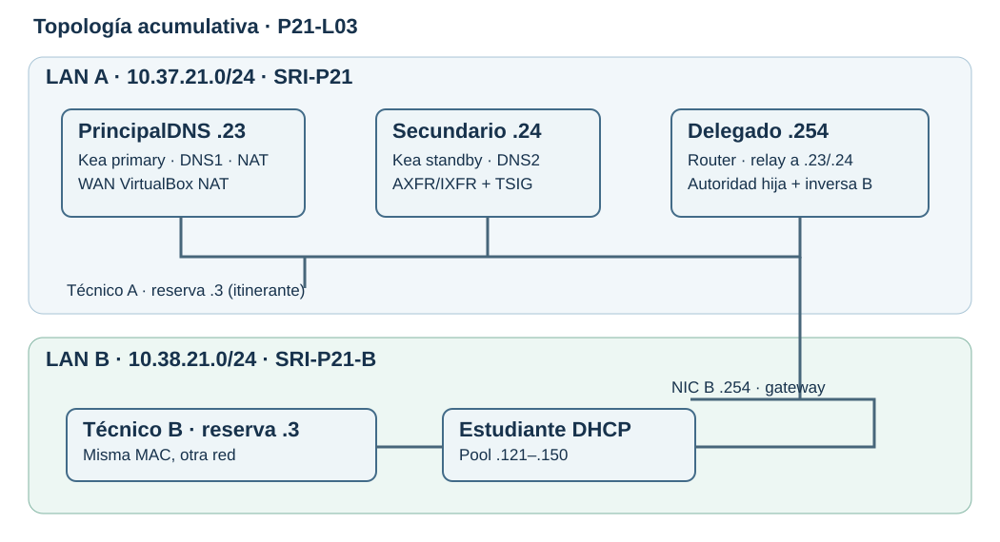

<a id="inicio"></a>
## Misión

Tras Kea DHCP, aprenderás a administrar DNS en Linux desde la resolución local hasta una red integrada con redundancia y DDNS. Avanza sesión a sesión; las 14 h de programación cubren el núcleo y las fases avanzadas/proyecto se calendarizarán con el profesor. No se usa Windows Server.

## Resultado de aprendizaje y correspondencia
RA1. Administra servicios de resolución de nombres, analizándolos y garantizando la seguridad del servicio. La tabla es una paráfrasis del RD 1629/2009, módulo 0375; no sustituye la programación del centro.

| CE | Evidencia | Sesiones / prácticas |
|---|---|---|
| RA1.a | Escenarios y necesidad | S01, DNS01/03 |
| RA1.b | Mecanismos de resolución | S01/S03, DNS01/02/03 |
| RA1.c | Jerarquía y nomenclatura | S01/S02/S06, DNS01/06 |
| RA1.d | Instalación y configuración | S02–S10, DNS02–08 |
| RA1.e | Reenvío a otro DNS | S05/S10, DNS05/PA03 |
| RA1.f | Almacena/distribuye respuestas | S05, DNS05/PA03 |
| RA1.g | Zonas, correo y alias | S02/S03/S06, DNS01/02/06 |
| RA1.h | Solución con IP dinámica | S07/S08, DNS07/PA03 |
| RA1.i | Transferencia entre servidores | S04, DNS04/PA03 |
| RA1.j | Documentación instalación/configuración | Todas |

RA2 se retoma de UT01 como integración, sin convertir DHCP en RA1. Las actividades de seguridad atraviesan RA1.

<a id="redes"></a>
## Convenciones del laboratorio

Ejemplo común P21-L03 (P=21, L=03; A=01…Z=26, Ñ→N, vocales sin tilde). Sustituye todos los datos de ejemplo por tu variante, no solo las IP. Escribe los octetos sin ceros iniciales. Las VM son Debian 13. En una terminal, `su -` para entrar como root; los comandos de administración se muestran como root sin sudo. En nano: Ctrl+O, Intro, Ctrl+X. Los comandos de cliente pueden ejecutarse sin root salvo los de red/captura. No pegues el prompt ni las salidas de ejemplo.

| Elemento | Regla | Ejemplo P21-L03 |
|---|---|---|
| LAN A / LAN B | 10.37.P.0/24 / 10.38.P.0/24 | 10.37.21.0/24 / 10.38.21.0/24 |
| PrincipalDNS (Kea+DNS1+gateway final) | 10.37.P.(20+L) | 10.37.21.23 |
| Secundario (Kea+DNS2) | 10.37.P.(21+L) | 10.37.21.24 |
| Delegado (router/relay/DNS hijo) | 10.37.P.254 / 10.38.P.254 | 10.37.21.254 / 10.38.21.254 |
| Técnico reservado en ambas LAN | 10.37.P.3 / 10.38.P.3 | 10.37.21.3 / 10.38.21.3 |
| Cliente fijo de ensayos A/B | 10.37.P.(210+L) / 10.38.P.(210+L) | 10.37.21.213 / 10.38.21.213 |
| Web, mail1, mail2, ftp (registros de inventario) | últimos octetos 70, 71, 72, 73 | 10.37.21.70–73 |
| Pool en ambas LAN | 100+P a 129+P | .121–.150 |
| Reserva previa UT01 (si existe) | 180+L | .183 |
| Dominio padre / hijo | pXX-lYY.sri.test / alumno.pXX-lYY.sri.test | p21-l03.sri.test / alumno.p21-l03.sri.test |
| Inversas A/B | P.37.10.in-addr.arpa / P.38.10.in-addr.arpa | 21.37.10.in-addr.arpa / 21.38.10.in-addr.arpa |
| Red interna VirtualBox | SRI-Pxx / SRI-Pxx-B | SRI-P21 / SRI-P21-B |
| TTL inicial / negativo | 300+10×L / 60+L s | 330 / 63 s |

Se reutilizan las VM y direcciones de Kea de UT01 (no se instala otro DHCP). Si ya montaste DNS dedicado .33/.43 con la versión anterior, conserva snapshot y migra las zonas a .23/.24 para este itinerario o adapta TODAS las referencias y rutas con autorización docente. Se eligen IP fijas para servidores/router: evitan dependencia circular al arrancar HA y el relay. Las reservas se demuestran con el técnico y, si procede, un cliente de prueba; la reserva no debe coincidir con una IP de infraestructura. Los hosts ficticios 70–73 no requieren VM; sus registros no prueban disponibilidad de servicios. Los rangos no se solapan para P=1…40 y L=1…26. Mantén NAT solo donde se indique; jamás puente a la red del centro. Antes de cada fase: snapshot coherente de las VM apagadas, copia de los ficheros tocados y anota hostname, fecha, rol y resultado. Si falla un control, no avances. Las salidas ilustrativas no son capturas reales.




<a id="s01"></a>
## S01 · Fundamentos, laboratorio y resolución local

### Objetivo y conceptos
DNS nació para sustituir la distribución centralizada de HOSTS.TXT (problemas de tamaño, tráfico, colisiones y administración); RFC 882/883 en 1983, después RFC 1034/1035. Es una base distribuida de RR, no un listado universal de máquinas. Sirve para IP, correo, descubrimiento de servicios, políticas y múltiples destinos. Dos A no constituyen un balanceador con comprobación de salud. El árbol tiene raíz `.`, TLD (.es ccTLD, .org gTLD, .cat patrocinado), dominios y subdominios. ICANN coordina identificadores, IANA gestiona funciones de raíz, registry opera un TLD, registrar tramita registros, registrant es titular; contratar dominio no equivale a alojar DNS. Hay 13 identificadores lógicos raíz A–M, con muchas instancias anycast; se anuncia la misma dirección desde distintos lugares, el encaminamiento selecciona ruta, no necesariamente distancia geográfica. Un FQDN termina en la raíz; `web` es relativo. `alumno.Z` es subdominio, solo es zona separada cuando hay corte de autoridad. `.test` está reservado para pruebas. No se publican las zonas privadas en Internet.

### Paso 1 · Inventario y VirtualBox (Principal y Cliente A)
Apaga VM. VirtualBox → Configuración → Red: adaptador 1 NAT temporal (instalar), adaptador 2 Red interna SRI-P21, cable conectado. Si clonas, usa base Debian limpia y genera MAC nuevas, no clones una VM Kea activa. Principal conserva .23 de UT01, cliente .213. Apunta MAC y nombre de NIC; en cada VM ejecuta:
```bash
ip -br link
ip -br address
ip route
hostnamectl
systemctl is-active networking NetworkManager systemd-networkd
```
Si ya funciona UT01 no cambies la IP del principal. En cliente, con ifupdown, copia `/etc/network/interfaces`, conserva loopback y NAT temporal, cambia solo bloque NIC interna (ejemplo enp0s8):
```text
auto enp0s8
iface enp0s8 inet static
    address 10.37.21.213/24
```
Desde consola local `ifdown enp0s8; ifup enp0s8`. Si NetworkManager gestiona NIC: `nmcli con show`; sustituye CON por el nombre real: `nmcli con mod "CON" ipv4.method manual ipv4.addresses 10.37.21.213/24 ipv4.gateway "" ipv4.never-default yes`; `nmcli con up "CON"`. Para networkd, usa el .network de esa NIC con `[Match] Name=enp0s8` y `[Network] Address=10.37.21.213/24` en líneas separadas, `networkctl reload; networkctl reconfigure enp0s8`. No mezcles gestores. Instala en cliente `apt update && apt install -y dnsutils tcpdump curl iputils-ping` mientras NAT funcione. Apaga y desactiva NAT del cliente (Principal puede mantener NAT de instalación, todavía no es router). Verifica desde cliente `ping -c 2 10.37.21.23`. No necesita gateway para LAN A.

### Paso 2 · Cliente A: resolución local sin BIND
```bash
hostnamectl set-hostname cli-p21-l03
cp -a /etc/hosts /root/hosts.s01.bak
cat /etc/hostname
hostname -f
 grep '^hosts:' /etc/nsswitch.conf
ls -l /etc/resolv.conf
cat /etc/resolv.conf
```
En `/etc/hosts` conserva localhost e IPv6, adapta la línea de identidad local a `127.0.1.1 cli-p21-l03` si corresponde; añade `10.37.21.23 principal.p21-l03.sri.test principal`. Si NSS tiene `files` antes de `dns`, `getent ahostsv4 principal` devuelve .23 sin consulta DNS. `ping -c 2 principal` muestra la IP y prueba ICMP; `dig @10.37.21.23 principal.p21-l03.sri.test A +time=2 +tries=1` aún no tiene por qué responder. Si NSS usa otras fuentes, explica el orden real; no cambies la línea networks ni borres módulos sin entenderlos. En una segunda VM comprueba que la entrada no se propaga. En cliente elimina solo la entrada añadida al terminar.

### Paso 3 · Demostración de jerarquía (solo con conectividad, desde Principal)
```bash
apt update && apt install -y dnsutils
dig . NS
dig org. NS
dig +trace example.org A
```
Identifica referencias, servidor consultado y respuesta final; `+trace` requiere acceso directo DNS hacia Internet, puede estar bloqueado. Alternativa: dibuja raíz → org → example.org y consulta el árbol local en S06. No uses `+trace` de .test contra raíz pública. Un stub del SO pide recursión al resolver (RD=1); el resolver itera por referencias o reenvía. Una respuesta puede ser dato, referencia, inexistencia o error; no se garantiza éxito.

### Control de salida
Cliente alcanza Principal por IP; demuestra diferencia `getent`/`dig` y documenta gestor de red, MAC e interfaces. Si ping falla: revisar red interna exacta, máscara y cable, `ip route get 10.37.21.23`, no DNS. Guarda snapshot S01_IP_OK. Pregunta: ¿por qué una zona no es lo mismo que un dominio? ¿Qué cambia al registrar un dominio público?

<a id="s02"></a>
## S02 · Autoridad BIND9 y zona directa

### Qué vamos a construir
Principal responde como autoridad de Z. `named` es el proceso, BIND9 el software. Un servidor puede ser primario de una zona y secundario de otra; ambos pueden responder con autoridad. En esta fase no es resolver recursivo. Puerto 53 UDP y TCP; no confundas 953/TCP (RNDC local de administración) ni 8000/TCP (API HA de Kea).

### Paso 1 · Principal: instalar y preparar
```bash
apt update
apt install -y bind9 bind9-utils dnsutils tcpdump
named -V | head -n 3
systemctl status named --no-pager
ss -lntup | grep ':53'
cp -a /etc/bind /root/bind.s02.bak
```
`named.conf` incluye options, local y default-zones; `/etc/bind` para estáticas, `/var/cache/bind` para secundarias, `/var/lib/bind` para dinámicas y journals. Si `named` no existe busca `systemctl list-unit-files | grep -E 'named|bind9'`. Si puerto ocupado identifica proceso; no desactives servicios a ciegas.

### Paso 2 · Principal: política y declaración
Sustituye el contenido de `/etc/bind/named.conf.options` (solo en este lab) por:
```conf
options {
    directory "/var/cache/bind";
    listen-on { 127.0.0.1; 10.37.21.23; };
    listen-on-v6 { none; };
    allow-query { localhost; 10.37.21.0/24; 10.38.21.0/24; };
    recursion no;
    allow-recursion { none; };
    allow-query-cache { none; };
    allow-transfer { none; };
    dnssec-validation auto;
};
```
`listen-on` controla sockets, `allow-query` clientes, `allow-recursion` quién puede usar resolución externa. `dnssec-validation auto` se conserva para la fase recursiva, no firma nuestra zona. Añade a `/etc/bind/named.conf.local`:
```conf
zone "p21-l03.sri.test" {
    type primary;
    file "/etc/bind/db.p21-l03.sri.test";
    allow-transfer { none; };
};
```
`type master` es sinónimo histórico de primary; `file` no crea registros. Crea `nano /etc/bind/db.p21-l03.sri.test` con contenido completo:
```dns
$ORIGIN p21-l03.sri.test.
$TTL 330
@ IN SOA ns1.p21-l03.sri.test. hostmaster.p21-l03.sri.test. (
    1   ; serial
    300 ; refresh
    60  ; retry
    86400 ; expire (laboratorio)
    63 ) ; negative TTL
@     IN NS    ns1.p21-l03.sri.test.
ns1   IN A     10.37.21.23
cli   IN A     10.37.21.213
web   IN A     10.37.21.70
mail1 IN A     10.37.21.71
mail2 IN A     10.37.21.72
files IN A     10.37.21.73
www   IN CNAME web.p21-l03.sri.test.
ftp   IN CNAME files.p21-l03.sri.test.
@     IN MX 13 mail1.p21-l03.sri.test.
@     IN MX 23 mail2.p21-l03.sri.test.
@     IN TXT   "laboratorio P21-L03"
_ssh._tcp IN SRV 0 10 22 ns1.p21-l03.sri.test.
@     IN CAA 0 issue ";"
web6  IN AAAA  2001:db8:21::70
```
`@`=origen; sin punto final, BIND concatena origen; `IN`=clase Internet. RR: owner, TTL opcional, clase, tipo, RDATA. SOA MNAME=primario, RNAME=hostmaster@dominio (primer punto no escapado), serial es contador de 32 bits comparado según RFC 1982; refresh consulta cambios; retry reintenta; expire limita autoridad secundaria sin contacto; TTL negativo es mínimo entre SOA TTL y MINIMUM, no TTL de todos los registros. En producción se dimensionan según SLA (expire días/semanas). A/AAAA direcciones; CNAME alias exclusivo (no otros datos normales en mismo owner); NS/MX apuntan a nombres canónicos con A/AAAA, no alias; menor MX es preferido. SRV prioridad, peso, puerto, objetivo; CAA restringe CA autorizadas (`issue ";"` prohíbe emisión ordinaria); TXT texto, no configura correo por sí solo. IPv6 2001:db8::/32 es documentación: sin interfaz IPv6 real no habrá conectividad. No confundir DNS con tener realmente SSH/mail/web.

### Paso 3 · Principal: comprobar y aplicar
```bash
named-checkconf
named-checkzone p21-l03.sri.test /etc/bind/db.p21-l03.sri.test
named-checkconf -z
systemctl reload named
journalctl -u named -n 30 --no-pager
rndc zonestatus p21-l03.sri.test
```
Esperado `loaded serial 1` y `OK`. `-z` prueba carga de primarias; no garantiza cliente accesible. En primera declaración usa recarga global, no `rndc reload Z` antes de que exista. En cambios de RR incrementa serial y `rndc reload Z`.

### Paso 4 · Cliente A: probar los registros (sin cambiar resolver)
```bash
dig @10.37.21.23 ns1.p21-l03.sri.test. A +norecurse
dig @10.37.21.23 www.p21-l03.sri.test. A
dig @10.37.21.23 p21-l03.sri.test. MX
dig @10.37.21.23 p21-l03.sri.test. SOA
dig @10.37.21.23 p21-l03.sri.test. TXT
dig @10.37.21.23 _ssh._tcp.p21-l03.sri.test. SRV
dig @10.37.21.23 p21-l03.sri.test. CAA
dig @10.37.21.23 web6.p21-l03.sri.test. AAAA
```
Ejemplo de respuesta (extracto esperado): `status: NOERROR`, `flags: qr aa`, `ns1.p21-l03.sri.test. 330 IN A 10.37.21.23`. `aa` prueba autoridad, `SERVER` indica a quién preguntamos; RD puede aparecer si lo pedimos y RA no debe aparecer con recursión desactivada. Error típico: falta `;` en config o punto en SOA/NS; localiza línea indicada, valida de nuevo y recarga. Snapshot S02_DIRECTA.

<a id="s03"></a>
## S03 · Inversa, resolver Linux y protocolo DNS


### Paso 1 · Principal: crear inversa IPv4
Para /24 se invierten los tres octetos de red, y el owner es último octeto: 10.37.21.23 → 23.21.37.10.in-addr.arpa. La inversa IPv6 usa nibbles hexadecimales invertidos bajo ip6.arpa (no in-addr.arpa); por ejemplo 2001:db8::/32 empieza en `8.b.d.0.1.0.0.2.ip6.arpa.`. Para prefijos IPv4 no /8,/16,/24 se requiere delegación sin clase (RFC 2317), no inventar octetos.
Añade a `/etc/bind/named.conf.local`:
```conf
zone "21.37.10.in-addr.arpa" {
    type primary;
    file "/etc/bind/db.10.37.21.rev";
    allow-transfer { none; };
};
```
Crea `/etc/bind/db.10.37.21.rev`:
```dns
$TTL 330
@ IN SOA ns1.p21-l03.sri.test. hostmaster.p21-l03.sri.test. (
    1 300 60 86400 63 )
@   IN NS  ns1.p21-l03.sri.test.
23  IN PTR ns1.p21-l03.sri.test.
213 IN PTR cli.p21-l03.sri.test.
70  IN PTR web.p21-l03.sri.test.
71  IN PTR mail1.p21-l03.sri.test.
72  IN PTR mail2.p21-l03.sri.test.
73  IN PTR files.p21-l03.sri.test.
```
Valida y recarga:
```bash
named-checkzone 21.37.10.in-addr.arpa /etc/bind/db.10.37.21.rev
named-checkconf -z && rndc reload
```
Cliente: `dig @10.37.21.23 -x 10.37.21.213` → `cli.p21-l03.sri.test.`. Comprueba su A; A no implica PTR y viceversa. PTR no autentica identidad; se usa en logs y diagnóstico/correo. No pongas PTR de todos los alias.

### Paso 2 · Cliente A: configurar DNS por el gestor real
```bash
ls -l /etc/resolv.conf
cat /etc/resolv.conf
systemctl is-active systemd-resolved NetworkManager
```
Si archivo regular NO gestionado y cliente fijo aislado: copia `cp -a /etc/resolv.conf /root/resolv.s03.bak` y edita con `search p21-l03.sri.test` y `nameserver 10.37.21.23` en líneas separadas. No uses chattr +i. Si NetworkManager: `nmcli con mod "CON" ipv4.dns 10.37.21.23 ipv4.dns-search p21-l03.sri.test ipv4.ignore-auto-dns yes`; `nmcli con up "CON"`. GUI XFCE: icono red → Editar conexiones → Ethernet interna → IPv4 → DNS y dominios de búsqueda (desactivar automático solo cuando proceda), guardar y reconectar. Para systemd-resolved activo: `resolvectl dns enp0s8 10.37.21.23` y `resolvectl domain enp0s8 p21-l03.sri.test` (temporal); persiste en .network con `DNS=` y `Domains=`. Si ifupdown usa resolvconf, `dns-nameservers` y `dns-search` en la interfaz solo si integración instalada. No pongas un DNS público como alternativo de zona privada. Prueba:
```bash
getent ahostsv4 ns1
host ns1.p21-l03.sri.test 10.37.21.23
nslookup ns1.p21-l03.sri.test 10.37.21.23
dig +search ns1 A
ping -c 2 ns1
```
Añade temporalmente `10.37.21.99 ns1.p21-l03.sri.test ns1` a hosts (asegura files primero); `getent` da .99, `dig @...` da .23. Elimina línea y repite. No envíes tráfico al host falso. Si `dig` funciona y `getent` no, revisa NSS y resolver; si ping muestra IP pero no recibe respuesta, DNS ya resolvió.

### Paso 3 · Cliente A: capturar protocolo
Terminal 1 como root: `tcpdump -ni enp0s8 -s0 -w /tmp/dns-s03.pcap 'host 10.37.21.23 and port 53'`. Terminal 2:
```bash
dig @10.37.21.23 ns1.p21-l03.sri.test. A
dig @10.37.21.23 ns1.p21-l03.sri.test. A +tcp
dig @10.37.21.23 inexistente.p21-l03.sri.test. A +norecurse
dig @10.37.21.23 ns1.p21-l03.sri.test. AAAA +norecurse
```
Detén captura Ctrl+C; `tcpdump -nn -vv -r /tmp/dns-s03.pcap`. Opcional GUI Wireshark en host: abrir pcap transferido de forma segura, filtro `dns`, después `tcp.port == 53`, expandir Domain Name System. Identifica puerto origen efímero, destino 53, ID y respuesta con mismo ID, QR, opcode QUERY, RCODE; pregunta QNAME/QTYPE/QCLASS, ANSWER RR, AUTHORITY (SOA negativa o NS referencia), ADDITIONAL (glue/OPT). RD pide recursión, RA la ofrece, AA autoridad, TC truncado, AD autenticado por resolver validador, CD pide no comprobar. EDNS(0) OPT anuncia capacidad UDP; si TC se reintenta TCP; TCP también sirve consultas normales y AXFR. No confundas UDP 53 con solo UDP: TCP es obligatorio en DNS moderno.

### Paso 4 · Interpretar errores
NXDOMAIN=nombre no existe; NOERROR sin RR del tipo pedido (NODATA)=nombre existe; REFUSED=política; SERVFAIL=fallo procesamiento, validación o zona; timeout=sin respuesta (ruta/puerto/cortafuegos). Si no hay recursión, una consulta externa puede ser REFUSED. Prueba un AAAA inexistente de ns1 para NODATA, no de un nombre inexistente. Consulta explícita antes de tocar configuración. Guarda pcap, salidas completas y snapshot S03_CLIENTE.

<a id="s04"></a>
## S04 · Secundario, transferencias y TSIG

### Paso 1 · Secundario: preparar segunda autoridad
Reutiliza standby Kea .24 de UT01, sin cambiar su IP. Si no existe, prepara Debian base en la misma LAN y fija .24 (no lo conviertas en DHCP nuevo). Instala `apt update && apt install -y bind9 bind9-utils dnsutils tcpdump` con NAT temporal. Copia `/etc/bind` como respaldo. En options usa el mismo bloque de S02 cambiando listen-on a .24; conserva `recursion no`. Después retira NAT de Secundario cuando no sea necesario. Comprueba ping A↔BIND2 (LAN A). En Principal añade a directa `@ IN NS ns2.p21-l03.sri.test.` y `ns2 IN A 10.37.21.24`; en inversa añade NS y `24 IN PTR ns2.p21-l03.sri.test.`. Incrementa ambos seriales a 2.

### Paso 2 · Transferencia inicial restringida por IP
Principal: en cada zona de `named.conf.local` reemplaza `allow-transfer { none; };` por:
```conf
allow-transfer { 10.37.21.24; };
also-notify { 10.37.21.24; };
notify yes;
ixfr-from-differences yes;
```
Secundario: `/etc/bind/named.conf.local` (solo zonas nuevas; no dupliques):
```conf
zone "p21-l03.sri.test" {
    type secondary;
    primaries { 10.37.21.23; };
    file "/var/cache/bind/db.p21-l03.sri.test";
    allow-transfer { none; };
};
zone "21.37.10.in-addr.arpa" {
    type secondary;
    primaries { 10.37.21.23; };
    file "/var/cache/bind/db.10.37.21.rev";
    allow-transfer { none; };
};
```
En ambos `named-checkconf -z && rndc reload` (primario primero). Secundario `journalctl -u named -n 50 --no-pager`; `rndc zonestatus p21-l03.sri.test`; `ls -l /var/cache/bind/`. BIND crea copia (puede ser raw binaria, no editar ni copiar a mano; `named-checkzone -f raw -D Z fichero` si raw). Desde Secundario `dig @10.37.21.23 p21-l03.sri.test AXFR`; desde cliente mismo comando debe fallar. Desde Cliente consulta `dig @10.37.21.24 p21-l03.sri.test SOA +norecurse` y PTR; AA en ambos. NOTIFY despierta consulta SOA; no envía zona por sí mismo. Transferencia sucede mientras primario está vivo, no al caerse.

### Paso 3 · Autenticar transferencias
En Principal `umask 077; tsig-keygen -a hmac-sha256 xfr-lab > /root/xfr-lab.key`; `install -o root -g bind -m 640 /root/xfr-lab.key /etc/bind/xfr-lab.key`. Traslada LA MISMA clave al Secundario mediante canal autorizado (scp sobre SSH si instalado, o medio privado docente), allí `install -o root -g bind -m 640 /root/xfr-lab.key /etc/bind/xfr-lab.key`; elimina copias temporales cuando no sean necesarias. No incluyas el secreto en entregas. En ambos, al comienzo de local (una sola vez): `include "/etc/bind/xfr-lab.key";`.
Principal en cada zona sustituye dos líneas:
```conf
allow-transfer { key xfr-lab; };
also-notify { 10.37.21.24 key xfr-lab; };
```
Secundario en cada zona:
```conf
primaries { 10.37.21.23 key xfr-lab; };
allow-notify { key xfr-lab; };
```
No dejes primaries repetido. ACL con IP y key en lista simple es OR, no AND; se exige clave, y se restringe red por firewall/escucha. `named-checkconf -z && rndc reload` en ambos. En Secundario `rndc retransfer p21-l03.sri.test` y después:
```bash
dig @10.37.21.23 p21-l03.sri.test AXFR
dig -k /etc/bind/xfr-lab.key @10.37.21.23 p21-l03.sri.test AXFR
```
Sin clave rechazada incluso desde secundario; con clave autorizada. TSIG autentica mensajes con HMAC y tiempo, no cifra; sincroniza relojes (`timedatectl`). Diagnostica BADKEY/BADSIG/BADTIME (nombre/secreto/reloj).

### Paso 4 · Cambio real, IXFR y continuidad
Anota serial actual S (ejemplo 2). Principal añade `monitor IN A 10.37.21.74`, incrementa directa a 3; `named-checkzone Z fichero` con valores reales y `rndc reload p21-l03.sri.test`. En Secundario consulta logs xfer y `dig @10.37.21.24 monitor.p21-l03.sri.test A`. Prueba `dig -k /etc/bind/xfr-lab.key @10.37.21.23 p21-l03.sri.test IXFR=2` (usa serial anterior real). IXFR necesita historial; puede caer a AXFR válidamente. Diferencia SOA inicial/final y RR eliminados/añadidos, guarda logs o explica fallback. No prometas que siempre es incremental. Si serial no aumenta, el secundario normalmente no solicita nueva versión; repite incrementando. En cliente configura DNS .23 y .24 con el método S03 y comprueba ambos explícitamente. Principal `systemctl stop named` (NO Kea); Cliente `dig @10.37.21.24 ns1.p21-l03.sri.test A +norecurse`; prueba resolver del SO, puede tardar. Arranca `systemctl start named`; verifica serial y ambas zonas. El secundario no es un standby DHCP: responde en normal y deja de servir zona al expirar si no refresca. Snapshot S04_XFR.

<a id="s05"></a>
## S05 · Recursión, caché y reenviadores

### Objetivo
Separar autoridad de resolver: una respuesta local AA no prueba caché; caché de terceros reduce consultas y caduca. Un reenviador es el destino al que otro resolver envía consultas; un servidor puede hacer ambas funciones. DNS público no sustituye servidor de zona privada. El Principal será resolver autorizado para ambas LAN. Secundario se configurará como resolver también al finalizar proyecto (con salida por gateway).

### Paso 1 · Principal: recursión restringida
En options de S02 reemplaza `recursion no`, `allow-recursion` y `allow-query-cache` por:
```conf
recursion yes;
allow-recursion { localhost; 10.37.21.0/24; 10.38.21.0/24; };
allow-query-cache { localhost; 10.37.21.0/24; 10.38.21.0/24; };
```
No cambies allow-query/listen-on; `named-checkconf && rndc reconfig`. En cliente consulta Z (AA) y observa RA. Para prueba negativa sin otra VM, en Principal temporalmente restringe ambas ACL de recursión a localhost, mantén allow-query y consulta desde cliente una zona externa/no local: REFUSED o recursión no disponible, pero la zona propia debe responder. Restaura ACL y recarga. Esto simula cliente no autorizado sin exponer a Internet.

### Paso 2 · Variante online (Principal con NAT)
VirtualBox NAT conectado, `ip route` debe tener salida por NIC NAT, no por LAN A. Comprueba `dig @8.8.8.8 example.org A +time=2 +tries=1`; si política del centro bloquea, usa resolver autorizado o alternativa offline. Añade dentro de options:
```conf
forwarders { 8.8.8.8; 1.1.1.1; };
forward only;
```
`forward only` no intenta iteración directa si falla upstream; `forward first` sí puede. Conserva validación DNSSEC. `named-checkconf && rndc reconfig`; `rndc flushname example.org` (solo lab). En cliente:
```bash
dig @10.37.21.23 example.org A +stats
sleep 5
dig @10.37.21.23 example.org A +stats
```
Anota SERVER=.23, TTL y latencia. En Principal captura en NIC NAT (ej. enp0s3) `tcpdump -ni enp0s3 'port 53'` durante ambas; con caché caliente puede no haber consulta upstream. TTL puede variar y segunda latencia no tiene obligación de ser 0. No hagas flush global fuera del lab.

### Paso 3 · Variante offline reproducible (también útil online)
En Secundario añade zona primaria independiente a local:
```conf
zone "cache.test" { type primary;
    file "/etc/bind/db.cache.test"; };
```
Crea `/etc/bind/db.cache.test`:
```dns
$TTL 120
@ IN SOA ns.cache.test. hostmaster.cache.test. ( 1 300 60 86400 60 )
@ IN NS ns.cache.test.
ns IN A 10.37.21.24
app IN A 10.37.21.70
```
`named-checkconf -z && rndc reload`. En Principal añade a local:
```conf
zone "cache.test" {
    type forward;
    forward only;
    forwarders { 10.37.21.24; };
};
```
En options de Principal añade `validate-except { "cache.test"; };` exclusivamente para ese dominio privado sin cadena pública; no desactives DNSSEC global. `named-checkconf && rndc reconfig`; `rndc flushname app.cache.test`; captura LAN A `tcpdump -ni enp0s8 'host 10.37.21.24 and port 53'`; cliente consulta `dig @10.37.21.23 app.cache.test A` dos veces separadas 5 s. Compara con `dig @10.37.21.24 app.cache.test A +norecurse` (AA, TTL de zona). Consulta `noexiste.cache.test` dos veces; en primera NXDOMAIN, SOA con TTL negativo, en segunda menor TTL. Añade `noexiste IN A 10.37.21.73` en Secundario, incrementa serial a 2, recarga, consulta directo (existe) y desde resolver (puede seguir negativo hasta TTL/flush). Principal `rndc flushname noexiste.cache.test`; repite. El TTL negativo efectivo es min(SOA TTL, MINIMUM)=60. No confundir serial con TTL. Si se bloquea la recursión, revisa allow-query, cache y forward zone. Si se usa solo offline, no afirmar salida Internet. Mantén `cache.test` como banco de pruebas o retíralo en ambos junto con su excepción (no otras zonas).

### Paso 4 · Conectividad no es DNS
Cliente A todavía puede no tener ruta por defecto. `dig @10.37.21.23 example.org A` puede funcionar y `ip route get 1.1.1.1` fallar. Ping no prueba HTTP ni DNS; en proyecto se añade ruta y NAT. Snapshot S05_CACHE.

<a id="s06"></a>
## S06 · Delegación real entre dos redes

### Objetivo y topología
La delegación cambia quién tiene autoridad sobre una rama del árbol; el relay DHCP reenvía peticiones de otro protocolo y el router enruta paquetes. Una misma VM puede asumir estos tres roles, pero son independientes. Principal y Secundario siguen en LAN A. Delegado tiene NIC A .254 y NIC B .254, y administra `alumno.p21-l03.sri.test` y la inversa de B. Cliente B inicialmente fijo .213; conserva Cliente A .213 (son redes diferentes). Si solo dispones de un cliente, muévelo apagado y cambia IP. Reutiliza router de UT01.

### Paso 1 · Delegado: red y encaminamiento
VirtualBox → adaptadores conectados a SRI-P21 y SRI-P21-B, sin NAT salvo durante instalación. Identifica nombres reales (`ip -br link`); ejemplo NIC A enp0s8, B enp0s9. En ifupdown, conserva loopback y define:
```text
auto enp0s8
iface enp0s8 inet static
    address 10.37.21.254/24

auto enp0s9
iface enp0s9 inet static
    address 10.38.21.254/24
```
`ifup` de cada NIC o reconfiguración del gestor real desde consola. En Delegado `printf 'net.ipv4.ip_forward=1\n' > /etc/sysctl.d/90-sri-routing.conf; sysctl --system; sysctl net.ipv4.ip_forward`. En Principal y Secundario: `ip route replace 10.38.21.0/24 via 10.37.21.254`; para persistencia ifupdown añade `post-up ip route replace 10.38.21.0/24 via 10.37.21.254` al bloque LAN A (en NM `ipv4.routes`, en networkd `[Route] Destination=... Gateway=...`). En Cliente A añade la misma ruta para esta fase si no tiene default; Cliente B IP .213/24 y `ip route replace default via 10.38.21.254` (persistir mediante su gestor). Desde B `ping -c 2 10.37.21.23`; desde Principal `ping -c 2 10.38.21.213`; si no, `ip route get` en cada extremo y `nft list ruleset` en router. No habilites NAT entre LAN A/B.

### Paso 2 · Delegado: autoridad de zona hija
Instala BIND y dnsutils antes de retirar NAT de instalación. Copia options de S02 pero `listen-on { 127.0.0.1; 10.37.21.254; 10.38.21.254; };`; por ahora `recursion no`. Declara en local:
```conf
zone "alumno.p21-l03.sri.test" {
    type primary;
    file "/etc/bind/db.alumno.p21-l03.sri.test";
    allow-transfer { none; };
};
zone "21.38.10.in-addr.arpa" {
    type primary;
    file "/etc/bind/db.10.38.21.rev";
    allow-transfer { none; };
};
```
Crea directa:
```dns
$TTL 330
@ IN SOA ns.alumno.p21-l03.sri.test. hostmaster.alumno.p21-l03.sri.test. (
    1 300 60 86400 63 )
@       IN NS ns.alumno.p21-l03.sri.test.
ns      IN A 10.37.21.254
portal  IN A 10.38.21.254
estudio IN A 10.38.21.213
www     IN CNAME portal.alumno.p21-l03.sri.test.
```
`ns` anuncia la IP de LAN A alcanzable desde las dos redes; `portal` identifica NIC B. Crea inversa B:
```dns
$TTL 330
@ IN SOA ns.alumno.p21-l03.sri.test. hostmaster.alumno.p21-l03.sri.test. (
    1 300 60 86400 63 )
@   IN NS ns.alumno.p21-l03.sri.test.
254 IN PTR portal.alumno.p21-l03.sri.test.
213 IN PTR estudio.alumno.p21-l03.sri.test.
```
`named-checkconf -z && rndc reload`; desde B `dig @10.38.21.254 estudio.alumno.p21-l03.sri.test A +norecurse` y `dig @10.38.21.254 -x 10.38.21.213` (AA).

### Paso 3 · Principal: introducir el corte de zona
En directa padre añade al final (fuera de otros RR):
```dns
alumno    IN NS ns.alumno.p21-l03.sri.test.
ns.alumno IN A  10.37.21.254
relay     IN A  10.37.21.254
```
Incrementa serial; en inversa A `254 IN PTR relay.p21-l03.sri.test.` e incrementa serial. El A de ns.alumno es glue porque el NS está dentro de la zona delegada; la copia autoritativa del A está en la hija. `relay` es nombre independiente. Valida `named-checkconf -z && rndc reload`. Desde cliente A:
```bash
dig @10.37.21.23 estudio.alumno.p21-l03.sri.test. A +norecurse
dig @10.37.21.254 estudio.alumno.p21-l03.sri.test. A +norecurse
dig @10.37.21.24 estudio.alumno.p21-l03.sri.test. A +norecurse
```
Primero y tercero: referencia NS en AUTHORITY y glue en ADDITIONAL (el tercero después de transferencia), no A final ni AA del padre para dato hijo; segundo: respuesta AA. Elimina temporalmente glue en una copia aislada de padre, incrementa serial, consulta referencia, explica dependencia circular; restaura con nuevo serial. No uses un `dig +trace` público para .test.

### Paso 4 · Resolver nombres de ambas redes
En Principal, amplía `validate-except` de S05 a `validate-except { "cache.test"; "p21-l03.sri.test"; "21.38.10.in-addr.arpa"; };` (solo nombres privados del lab); añade a local la zona de reenvío de inversa B, pues la inversa es árbol distinto:
```conf
zone "21.38.10.in-addr.arpa" {
    type forward;
    forward only;
    forwarders { 10.37.21.254; };
};
```
`named-checkconf && rndc reconfig`; `dig @10.37.21.23 estudio.alumno.p21-l03.sri.test A` y `dig @10.37.21.23 -x 10.38.21.213`. Si la consulta recursiva de hija falla con forward only global, añade una zona `type forward` para `alumno.p21-l03.sri.test` apuntando a .254; primero conserva evidencia de referencia sin ella y vuelve a probar +norecurse (reenvío selectivo es política de resolver, no sustituto de delegación). En Secundario configura recursión como S05, mismas excepciones privadas y zona forward inversa B; prueba hijo. Si no tiene salida externa todavía, no prometas Internet. En Delegado puedes activar recursión limitada a LAN A/B y `forwarders { 10.37.21.23; 10.37.21.24; }; forward only;` para nombres ajenos; en options `validate-except { "p21-l03.sri.test"; "21.37.10.in-addr.arpa"; };`. Nunca reenvíes su propia zona hija al padre, ni crees bucle de resolvers. Cliente B configura DNS .254 de B o .23/.24 del padre según fase; comprueba ambos mecanismos. En diseño final B usará .23/.24 para tolerancia ante caída de DNS padre, mientras la hija requiere Delegado operativo. Guarda S06_DELEGACION.

<a id="s07"></a>
## S07 · DDNS seguro manual: entender RFC 2136


### Por qué antes de Kea
DNS dinámico actualiza RR sin editar zona a mano. TSIG autentica la transacción, no cifra ni firma RR para clientes. El UPDATE viaja a puerto 53, no RNDC 953. Un servicio comercial DDNS (actualiza un nombre público si cambia IP WAN) es otro caso de uso; aquí administramos zonas propias. DHCID ayuda a detectar conflictos de identidad de clientes DHCP.

### Paso 1 · Principal: preparar zonas dinámicas y política
Guarda copia de `/etc/bind` y de estado antes de modificar. Directa padre y reversa A se volverán dinámicas, conservando sus secundarios y delegación. En Principal, crea clave separada de xfr:
```bash
umask 077
tsig-keygen -a hmac-sha256 manual-lab > /root/manual-lab.key
install -o root -g bind -m 640 /root/manual-lab.key /etc/bind/manual-lab.key
systemctl stop named
install -o bind -g bind -m 640 /etc/bind/db.p21-l03.sri.test /var/lib/bind/db.p21-l03.sri.test
install -o bind -g bind -m 640 /etc/bind/db.10.37.21.rev /var/lib/bind/db.10.37.21.rev
```
En local, incluye `include "/etc/bind/manual-lab.key";` una sola vez. Cambia las rutas `file` de esas dos zonas a /var/lib/bind/ conservando lo demás. En directa añade dentro de zone (sin allow-update simultáneo):
```conf
update-policy {
    grant manual-lab name prueba.p21-l03.sri.test. A;
};
```
En inversa A:
```conf
update-policy {
    grant manual-lab name 200.21.37.10.in-addr.arpa. PTR;
};
```
.200 está fuera del pool y no choca con reservas. No `chmod -R` ni AppArmor desactivado: el proceso bind debe poder crear .jnl en /var/lib/bind. `named-checkconf -z && systemctl start named`; `systemctl status named --no-pager` y `journalctl -u named -n 25 --no-pager`. Si fallo, revierte local desde copia y reinicia. No borres journals si existen. En cliente `dig @10.37.21.23 prueba.p21-l03.sri.test A` antes (NXDOMAIN).

### Paso 2 · Principal: nsupdate firmado (sin copiar secreto a cliente)
```text
nsupdate -k /etc/bind/manual-lab.key
server 10.37.21.23 53
zone p21-l03.sri.test.
update add prueba.p21-l03.sri.test. 120 A 10.37.21.200
send
zone 21.37.10.in-addr.arpa.
update add 200.21.37.10.in-addr.arpa. 120 PTR prueba.p21-l03.sri.test.
send
quit
```
`send` envía una transacción a UNA zona, no mezcles ambas en un UPDATE. Sin salida de error suele ser éxito; desde cliente `dig @10.37.21.23 prueba.p21-l03.sri.test A` y `dig @10.37.21.23 -x 10.37.21.200`; desde .24 comprueba propagación y SOA. En Principal `ls -l /var/lib/bind` y `rndc sync p21-l03.sri.test` (escribe journal a archivo sin detener updates). No edites a mano zona dinámica abierta.

### Paso 3 · Pruebas negativas y borrado
Ejecuta nsupdate SIN `-k` con mismo server/zone e `update add prueba... 120 A 10.37.21.201`, `send`, `quit` (escribe FQDN completo). Debe rechazar; con clave válida intenta `update add prohibido.p21-l03.sri.test. 120 A 10.37.21.200`, debe rechazar por política. Verifica que RR inicial no cambió. Para limpiar, con clave válida `update delete prueba.p21-l03.sri.test. A` / `send`; cambia zone inversa y `update delete 200.21.37.10.in-addr.arpa. PTR` / `send`; consulta ambas. `REFUSED` por política, `NOTAUTH` por autoridad/TSIG, `SERVFAIL` por procesamiento; usa logs para distinguir.

### Paso 4 · Cambios manuales y copias
Si necesitas editar una zona dinámica, `rndc freeze p21-l03.sri.test` (sincroniza y detiene updates); copia fichero y edita, incrementa serial superior al actual; `named-checkzone ...`; `rndc thaw p21-l03.sri.test`. Para inversa igual con su nombre. Si falla validación no hagas thaw hasta corregir o restaurar. No edites secundario. Snapshot coherente S07_DDNS_MANUAL. Pregunta: ¿por qué guardar solo el archivo estático antiguo pierde actualizaciones? ¿Qué pasa al caducar TTL en caché?

<a id="s08"></a>
## S08 · Kea D2: DNS dinámico automático


### Objetivo y fases
Cliente DHCP → Kea DHCP4 (UDP 67/68) → NCR a D2 local (UDP 53001) → UPDATE autenticado a BIND (53) → NOTIFY/transferencia a DNS2. Opciones 6/15 solo entregan resolver y dominio de búsqueda, no crean A/PTR. DDNS real es obligatorio en esta ampliación. Primero LAN A con principal y standby existente, después LAN B. No se instala isc-dhcp-server. No uses `nsupdate` para fabricar el resultado final: la evidencia debe nacer de DHCP. D2 no replica bases DNS ni es parte del protocolo HA.

### Paso 1 · Preparar BIND (Principal y Delegado)
En Principal genera clave distinta, en root con umask 077:
```bash
tsig-keygen -a hmac-sha256 kea-ddns > /root/kea-ddns.key
install -o root -g bind -m 640 /root/kea-ddns.key /etc/bind/kea-ddns.key
```
Incluye en local `include "/etc/bind/kea-ddns.key";`. En directa padre conserva grant de S07 y añade dentro de update-policy:
```conf
grant kea-ddns subdomain dyn.p21-l03.sri.test. A DHCID;
```
En reversa A añade reglas de owner exacto por IP de pool: genera líneas con este comando (NO lo pegues dentro de BIND, pega su salida en update-policy):
```bash
for n in $(seq 121 150) 3 183; do
  echo "grant kea-ddns name $n.21.37.10.in-addr.arpa. PTR DHCID;"
done
```
Incluye solo .183 si reserva de UT01 está vigente; para cualquier otra reserva real añade owner exacto. En caso de usar DDNS para técnico, elimina los PTR manuales de .3 previamente con freeze/thaw; no dupliques PTR estático y dinámico para esa IP. Los A estáticos `tecnico-a`/`tecnico-b` pueden existir como nombres de inventario, el PTR dinámico apunta al nombre dinámico. Mantén restringida la clave a tipos A/DHCID o PTR/DHCID, no SOA/NS. En Principal `named-checkconf -z && rndc reconfig`. Para LAN B, en Delegado instala la MISMA kea-ddns.key por canal privado; detén named, copia sus dos zonas estáticas a `/var/lib/bind/` con `install -o bind -g bind -m 640`, cambia rutas file, incluye la clave, añade `update-policy { grant kea-ddns subdomain dyn.alumno.p21-l03.sri.test. A DHCID; };` a directa, en inversa B genera reglas iguales sustituyendo `.21.37.10` por `.21.38.10` (sin .183 si no hay reserva). Valida y arranca named. Las zonas dinámicas deben poder escribir journal; `journalctl -k | grep -i denied` si error permisos. No toques todo /etc/bind.

### Paso 2 · D2 en los dos Kea (primero principal)
Instala `apt install -y kea-dhcp-ddns-server` con salida habilitada, confirma `kea-dhcp-ddns -V` y unidad `systemctl list-unit-files | grep kea-dhcp-ddns`. Debian 13 estable usa familia Kea 2.6.x; `secret-file` está disponible desde 2.5.8. En Principal y Secundario deposita solo el secreto base64 (sin comillas/espacios, misma clave que BIND) en `/etc/kea/ddns-secret` con `chown _kea:_kea` y `chmod 600`. En Principal puedes extraerlo sin mostrarlo:
```bash
umask 077
awk -F'"' '/secret / {print $2}' /root/kea-ddns.key > /etc/kea/ddns-secret
chown _kea:_kea /etc/kea/ddns-secret
chmod 600 /etc/kea/ddns-secret
```
Transfiere ese fichero al secundario por canal privado y aplica permisos. No pegues secreto en memoria o capturas. Copia `/etc/kea/kea-dhcp-ddns.conf` y sustituye su contenido por el ejemplo completo (en los dos nodos igual):
```json
{
  "DhcpDdns": {
    "ip-address": "127.0.0.1",
    "port": 53001,
    "ncr-protocol": "UDP",
    "ncr-format": "JSON",
    "tsig-keys": [ {
      "name": "kea-ddns", "algorithm": "HMAC-SHA256",
      "secret-file": "/etc/kea/ddns-secret"
    } ],
    "forward-ddns": { "ddns-domains": [
      { "name": "p21-l03.sri.test.", "key-name": "kea-ddns",
        "dns-servers": [ { "ip-address": "10.37.21.23", "port": 53 } ] },
      { "name": "alumno.p21-l03.sri.test.", "key-name": "kea-ddns",
        "dns-servers": [ { "ip-address": "10.37.21.254", "port": 53 } ] }
    ] },
    "reverse-ddns": { "ddns-domains": [
      { "name": "21.37.10.in-addr.arpa.", "key-name": "kea-ddns",
        "dns-servers": [ { "ip-address": "10.37.21.23", "port": 53 } ] },
      { "name": "21.38.10.in-addr.arpa.", "key-name": "kea-ddns",
        "dns-servers": [ { "ip-address": "10.37.21.254", "port": 53 } ] }
    ] }
  }
}
```
D2 selecciona dominio más específico por sufijo. Si todavía no has configurado Delegado, no generes leases en B hasta que esté operativo. Comprueba nombre de cuenta `systemctl show -p User,Group kea-dhcp-ddns-server`; valida como usuario real (ej. _kea):
```bash
su -s /bin/bash _kea -c '/usr/sbin/kea-dhcp-ddns -t /etc/kea/kea-dhcp-ddns.conf'
systemctl restart kea-dhcp-ddns-server
systemctl status kea-dhcp-ddns-server --no-pager
ss -lunp | grep 53001
```
Si unidad o binario distinto consulta `dpkg -L kea-dhcp-ddns-server` y `systemctl cat`. D2 solo escucha localhost; no expongas NCR a la LAN. Si loggers no se ajusta a versión, consulta ARM y conserva config por defecto de logging.

### Paso 3 · Kea DHCP4 en ambos nodos: integrar sin borrar HA
Haz copia de `/etc/kea/kea-dhcp4.conf`. Dentro de `Dhcp4` (mismo nivel que subnet4, no dentro de HA) añade o sustituye propiedades:
```json
"dhcp-ddns": {
  "enable-updates": true,
  "server-ip": "127.0.0.1", "server-port": 53001
},
"ddns-send-updates": true,
"ddns-override-no-update": true,
"ddns-override-client-update": true,
"ddns-replace-client-name": "always",
"ddns-generated-prefix": "host",
"ddns-update-on-renew": true
```
Son fragmentos: pon comas según posición. `always` genera nombres a partir de IP para un ensayo determinista y evita depender de opción 12/81 del cliente; en producción decide política de nombres e identidad. En cada objeto subnet4 añade `"ddns-qualifying-suffix": "dyn.p21-l03.sri.test."` para A y `"ddns-qualifying-suffix": "dyn.alumno.p21-l03.sri.test."` para B. En option-data de cada subred añade DNS y dominio de búsqueda correspondientes (B usa .23/.24 y `alumno...`). Mantén `routers` B=.254 y A=.23 solo cuando gateway esté listo. Si deseas nombres de host solicitados por cliente, alternativa posterior `when-not-present` y prueba FQDN enviado. Asegura que no haya dos propiedades iguales ni DHCP no coordinado.
```bash
su -s /bin/bash _kea -c '/usr/sbin/kea-dhcp4 -T /etc/kea/kea-dhcp4.conf'
```
Si -T no está en tu versión consulta `kea-dhcp4 -h`, usa -t y verifica hooks al arrancar. Reinicia un nodo cada vez, comprueba status HA antes de siguiente (ver S10). En lab aislado si HA no funciona, no dejes dos DHCP activos: para prueba D2 con un solo nodo usa snapshot de DHCP independiente, standby detenido, luego restaura pareja antes de proyecto. No confundas servicio verde con HA sincronizada.

### Paso 4 · Cliente DHCP nuevo y prueba automática
Cliente A: hostname individual, NIC interna en DHCP (ifupdown `iface enp0s8 inet dhcp` sin address; `ifdown ...; ifup ...` local; NM ipv4.method auto, limpia addresses/gateway y DNS manuales, `ipv4.ignore-auto-dns no`). Si es cliente nuevo genera MAC diferente; no uses IP fija anterior. En servidor `tail -n 10 /var/lib/kea/kea-leases4.csv`; apunta IP y hostname de la lease real; logs:
```bash
journalctl -u kea-dhcp4-server -n 50 --no-pager
journalctl -u kea-dhcp-ddns-server -n 60 --no-pager
journalctl -u named -n 50 --no-pager
```
En Cliente sustituye IP_REAL por lease obtenida, por ejemplo `dig @10.37.21.23 -x 10.37.21.121` devuelve hostname generado (consulta el nombre exacto, no lo inventes). `dig @10.37.21.23 NOMBRE_REAL A` y `dig @10.37.21.23 NOMBRE_REAL DHCID`; desde .24 consulta mismo A/PTR cuando sincronice. En B repite con MAC distinta, `dig @10.37.21.254 -x IP_REAL`, consulta directa a autoridad hija, luego resolver .23. Al liberar concesión, si cliente realmente envía RELEASE y Kea lo procesa, observa eliminación eventual; no supongas que desconectar cable libera lease. Verifica con pcap y logs. Si fallo: lease sin NCR (opciones y flags), NCR sin UPDATE (D2/53001), UPDATE rechazado (TSIG/owner/permisos), RR en autoridad pero no cliente (caché/NSS). Detener BIND principal no promueve secundario a escritor; DDNS A puede fallar aunque consultas y DHCP continúen. Snapshot S08_D2.

<a id="s09"></a>
## S09 · Administración gráfica, seguridad y operación

### Bloque A · Webmin (recuperación de @VANZA)
Webmin no sustituye saber los archivos. Usa snapshot aislado de S03 o clon limpio, nunca edites zonas dinámicas abiertas con GUI. Principal: NAT temporal para descargar desde repositorio oficial; como root:
```bash
apt update && apt install -y wget ca-certificates
wget -O /root/webmin-setup-repo.sh https://raw.githubusercontent.com/webmin/webmin/master/webmin-setup-repo.sh
less /root/webmin-setup-repo.sh
sh /root/webmin-setup-repo.sh
apt update && apt install -y webmin
systemctl status webmin --no-pager
ss -lntp | grep 10000
```
Revisa script antes de ejecutarlo; si el centro no autoriza repositorio externo, profesor prepara VM o realiza la demostración, no inventes evidencias. Retira NAT y acceso desde redes ajenas. Cliente XFCE navegador → `https://10.37.21.23:10000/` (solo laboratorio, verifica huella del certificado local con administrador antes de aceptar). Inicia sesión con cuenta administrativa autorizada, no reutilices contraseñas del centro; restringe Webmin a LAN y apágalo al finalizar (`systemctl disable --now webmin` en VM de prueba). Si no hay GUI en cliente, usa VM XFCE temporal en red interna; no abras puerto en el host público.
En Webmin → Servers → BIND DNS Server (si no aparece, Refresh Modules y comprueba instalación). Create master zone → Forward → Domain name `gui.p21-l03.sri.test`, master server `ns.gui.p21-l03.sri.test`, email hostmaster@... → Create. En esta VM/snapshot, crea nueva inversa para una RED DE ENSAYO no declarada (10.39.21.0/24; tipo Reverse y red 10.39.21). En zona directa, Address → `ns` .23 de LAN A (no marques inversa si corresponde a otra zona), `cenicienta` 10.39.21.70 y `pinocho` .71 (estos son datos ficticios), activa opción de actualización de inversa si existe para estos dos; Alias `www` a cenicienta FQDN; Mail server MX 13 a pinocho FQDN; si UI lo permite añade secundario NS solo si realmente existe, si no se hace ejercicio de diseño separado. Apply configuration. Comprueba `named-checkconf -z`, local y fichero de zona (`file` declarado), `dig @10.37.21.23 cenicienta.gui.p21-l03.sri.test A`, `dig @10.37.21.23 -x 10.39.21.70` y MX. Si Webmin no crea PTR automáticamente, créalo en zona inversa y documenta variante de UI; no atribuyas automatismo a BIND. GUI puede variar por versión. Compara diff antes/después y vuelve a snapshot final S08. No mezcles las dos inversas con misma red.

### Bloque B · Seguridad (sobre lab real, sin ataques externos)
Amenazas: spoofing/envenenamiento de caché (datos falsos), amplificación/reflexión y DDoS (abuso de recursión y capacidad de respuesta), tunneling (consultas anómalas que pueden ocultar datos). Mitigaciones: actualizaciones, ACL, separación de autoridad/recursión, limitar transferencias y updates TSIG, firewall, monitorizar volumen y NXDOMAIN, revisar respuestas grandes, DNSSEC, filtrado/RPZ donde proceda. DNSSEC valida origen/integridad de RRset y negación autenticada (DNSKEY, RRSIG, DS, NSEC/NSEC3); no cifra, no sustituye TSIG, no evita todos los DDoS. DoT/DoH cifran transporte hacia resolver; no prueban autoridad ni sustituyen DNSSEC. Evita capturar tráfico de terceros. Split-horizon/views y RPZ se estudian como ampliaciones de arquitectura: distintas respuestas según cliente y política de bloqueo, nunca para ocultar problemas de zona.
Con Principal conectado a Internet y recursión configurada: `dig @10.37.21.23 . DNSKEY +dnssec`, `dig @10.37.21.23 cloudflare.com A +dnssec`, `dig @10.37.21.23 dnssec-failed.org A +dnssec` (dominio de prueba externo, disponibilidad variable), compara con `+cdflag` solo para diagnóstico. Busca AD solo si resolver valida, no confundir DO (solicitar datos DNSSEC) con AD. Si dominio inválido da SERVFAIL y CD muestra datos, evidencia de validación; si no, documenta upstream y no lo afirmes. Sin Internet estudia RRSIG/DNSKEY conceptualmente y realiza pruebas ACL/TSIG reales. No desactives DNSSEC global para resolver SERVFAIL; excepciones solo .test privado. En servidor `rndc querylog on`, consulta cliente, `journalctl -u named -n 30 --no-pager`, `rndc querylog off`. Logs de consulta pueden contener datos privados y crecer; activar breve y borrar pcap de prueba si ya no se necesita.

### Bloque C · Recuperación
En Principal (root): `rndc freeze` si hay zonas dinámicas; crea `tar -czf /root/dns-backup.tgz /etc/bind /var/lib/bind`; `rndc thaw`. En Delegado repite por separado. Archivo privado contiene secretos, `chmod 600`. No restaurar /var/cache/bind como autoridad primaria. En clon desconectado o snapshot, simula fallo de sintaxis (quita ; en copia de config), `named-checkconf -z` antes de recarga debe detectarlo. Simula un RR borrado mediante freeze/edición/thaw o nsupdate según política; restaura archivo correcto desde backup a ubicación correspondiente y serial superior al distribuido (si restauras copia antigua, secundario puede ignorarla). Si restauración de zona dinámica completa: detener named, guardar estado actual incluyendo .jnl, restaurar copia coherente del fichero congelado y no mezclar journal de otra versión, validar, arrancar y comprobar ambos nodos. Nunca borres un journal activo para "arreglar". Entrega plan de rollback, tiempo medido y pruebas. Práctica de views/split DNS opcional: en clon configura dos views con `match-clients` y zona de ensayo en ambas, valida y prueba desde las dos redes, sin duplicar las default-zones fuera de views. No necesario para acumulativa.

<a id="s10"></a>
## S10 · Integración final: DHCP HA, relay, DNS y salida a Internet

### Objetivo
La infraestructura original pide que PrincipalDNS dé acceso a Internet a ambas LAN, entregue DHCP, tenga autoridad de padre y caché, Secundario respalde DHCP y DNS, y DelegadoEstudiantil sea relay y autoridad hija/inversa. Adaptamos .16/.32 del original a una única LAN B de UT01 y pool individual. 5 VM máximas: Principal, Secundario, Delegado, Técnico itinerante y Estudiante (puedes usar un cliente extra si quieres). No confundir fallo de named con caída de toda la VM principal: aquí gateway sigue siendo punto único de fallo.

### Paso 1 · Principal: NAT y routing (consola local)
VirtualBox: NAT en adaptador WAN (ej. enp0s3), interna A en enp0s8, no puente ni NAT en clientes. Comprueba `ip route get 1.1.1.1`, IP fija LAN .23 y salida NAT. Instala nftables y curl antes de retirar NAT de otras VM. Activa forwarding:
```bash
printf 'net.ipv4.ip_forward=1\n' > /etc/sysctl.d/90-sri-routing.conf
sysctl --system
ip route replace 10.38.21.0/24 via 10.37.21.254
nft list ruleset
```
En un laboratorio limpio (si hay firewall previo, integra reglas con docente, no lo borres), crea `/etc/nftables.d/sri-nat.nft` con el contenido siguiente (ajusta NIC WAN real):
```conf
table ip sri_nat {
    chain postrouting {
        type nat hook postrouting priority srcnat; policy accept;
        oifname "enp0s3" ip saddr { 10.37.21.0/24, 10.38.21.0/24 } masquerade
    }
}
```
`mkdir -p /etc/nftables.d` antes de editar; `nft -c -f /etc/nftables.d/sri-nat.nft`; si tabla no existe `nft -f ...`. Persiste añadiendo `include "/etc/nftables.d/sri-nat.nft"` a `/etc/nftables.conf` una sola vez (si ya hay glob no duplicar), comprueba `nft -c -f /etc/nftables.conf`, `systemctl enable nftables`. Si recargas configuración completa revisa si contiene flush ruleset; no hacerlo en producción. Si tabla ya existe usa regla idempotente o reemplazo de tabla controlado. `nft list table ip sri_nat`. El NAT ocurre solo a WAN; LAN A/B se enrutan. Si hay política DROP autoriza forwarding LAN→WAN y respuestas established/related y LAN A↔B según necesidad, más DNS/DHCP local; no abras administración WAN. Ejemplo para lab con filtro preexistente: agrega reglas al chain correcto tras inspección, no asumir nombre. En Delegado default vía .23 por NIC A, forwarding activo de S06; en Secundario default vía .23; rutas B vía .254 desde ambos servidores. En Cliente A default .23 y Cliente B .254. Persiste según gestor. Prueba desde cada uno `ip route get 1.1.1.1`, `curl -I --connect-timeout 5 https://example.org` después de DNS; captura WAN si falla. Internet condicionado a NAT y política del aula. Conectividad de B sin ruta de retorno no funciona.

### Paso 2 · Kea HA y reservas (ambos DHCP)
Conserva la configuración de UT01 y su pool individual .121–.150, misma configuración de subredes/IDs/reservas en ambos. En cada `option-data` A anuncia routers .23, domain-name Z y `domain-name-servers` .23,.24; B anuncia routers 10.38.21.254, domain-name alumno.Z y mismos DNS .23,.24. Ejemplo para A:
```json
"option-data": [
  {"name":"routers","data":"10.37.21.23"},
  {"name":"domain-name-servers","data":"10.37.21.23, 10.37.21.24"},
  {"name":"domain-name","data":"p21-l03.sri.test"}
],
"reservations": [
  {"hw-address":"08:00:27:12:34:56","ip-address":"10.37.21.3"}
]
```
MAC de ejemplo: usa la NIC real del Técnico, misma MAC al mover red interna; reserva B .3 de B en SU objeto subnet4. Si existen reservas previas conserva y añade, no dupliques clave reservations. Las IP fijas de infraestructura quedan fuera del pool. En ambos DHCP: `this-server-name` es local, los peers/roles permanecen idénticos (`asir` primary, `smr` standby si son tus nombres reales), mode `hot-standby`, `http-dedicated-listener: false` con Control Agent; socket UNIX `/run/kea/kea4-ctrl-socket` en DHCP y CA. Si CA tiene Basic Auth, cada objeto peer necesita credenciales de DESTINO (`basic-auth-user`, `basic-auth-password-file` o `basic-auth-password`; en lab si mismo usuario y contraseña ambos, fichero local protegido que contiene esa contraseña). No basta que curl autenticado funcione: las peticiones HA también deben autenticarse. Ejemplo dentro de cada peer:
```json
"basic-auth-user": "kea-api",
"basic-auth-password-file": "/etc/kea/kea-api-password"
```
Si contraseñas diferentes, fichero distinto por destino en cada nodo. Archivo `_kea:_kea` 600; no uses contraseñas de ejemplo en producción ni HTTP sin aislamiento. `su -s /bin/bash _kea -c '/usr/sbin/kea-dhcp4 -T /etc/kea/kea-dhcp4.conf'` y CA `-t` como _kea; arranca un nodo a la vez. Si versión no admite password-file, usar campo password protegido en configuración conforme ARM. Comprueba `ss -ltnp | grep ':8000'` CA dueño del puerto, y ambos `systemctl is-active kea-dhcp4-server kea-ctrl-agent`. En cada nodo, pide contraseña interactivamente:
```bash
curl -sS -u kea-api -H 'Content-Type: application/json' \
 -d '{"command":"status-get","service":["dhcp4"]}' \
 http://10.37.21.23:8000/
```
Repite .24. Busca `result:0`, estado local hot-standby e in-touch true del remoto, no solo status HTTP. Si HTTP_CLIENT_REQUEST_NO_AUTH_HEADER en journal del CA y compañero no está en contacto, revisar auth en peers. No fuerces partner-down si ambos pueden seguir dando leases. `max-unacked-clients: 0` simplifica detección en lab pero aumenta riesgo de split brain en partición; no extrapolar a producción.

### Paso 3 · Delegado: relay a ambos nodos
Ya existe relay de UT01 (si no: `apt install isc-dhcp-relay`, paquete histórico solo relay, no instalar ISC DHCP server). En `/etc/default/isc-dhcp-relay` configura `SERVERS="10.37.21.23 10.37.21.24"`, `INTERFACES="enp0s8 enp0s9"` (nombres reales), `OPTIONS=""`. `systemctl restart isc-dhcp-relay; systemctl status isc-dhcp-relay --no-pager`. `tcpdump -ni enp0s9 'udp port 67 or udp port 68'` y NIC A para observar giaddr B=.254. Kea selecciona subnet por giaddr. Comprueba rutas retorno y DHCP no activo en NAT. El router no necesita asignarse su propia IP por DHCP para funcionar.

### Paso 4 · DNS, movilidad y pruebas cruzadas
Secundario debe ser también resolver para ambas redes: usa options S05 con `listen-on` .24, forwarders autorizados, validate-except privada y forward inversa B de S06; `named-checkconf -z && rndc reload`; consulta externo explícito a .23 y .24. El Delegado administra hija e inversa B, principal/secondary pueden resolverlas cuando Delegado está operativo; no anunciar que hija tiene HA a menos que añadas otra secundaria. En Principal añade A de inventario `tecnico-a IN A 10.37.21.3` y en Delegado `tecnico-b IN A 10.38.21.3` con freeze/thaw de zonas dinámicas; PTR dinámicos cuando Kea D2 activo, si D2 no está activo añade PTR estático de técnico según zona. Al mover técnico apaga, VirtualBox → Red interna cambia A a B conservando MAC, enciende y renueva; debe obtener .3 en B, DNS según DHCP y salida; no tener dos NIC activas con misma MAC. En Estudiante (B) solicita IP dinámica y verifica A/PTR automáticos S08. En cliente consulta nombres padre/hijo, directa/inversa, `getent`, `dig @...`, `curl` exterior. Si cliente recibe DNS público por otra NIC, desactiva NAT/auto DNS indebido y revisa DHCP ACK opción 6/15. No uses dos gateways por defecto salvo diseño explícito.

### Paso 5 · Matriz de continuidad y recuperación
Caso 1 ambos vivos: desde A/B obtiene IP, logs/lease en los dos Kea, HA contacto, consulta DNS ambos y serial igual. Caso 2 detén SOLO `kea-dhcp4-server` en Principal, no BIND ni gateway; consulta estado .24, espera transición partner-down según timers y solicita nueva concesión con MAC nueva en B; debe responder standby vía relay. Comprueba A/PTR si DNS1 y D2 standby siguen accesibles. Reinicia DHCP principal y verifica contacto/leases antes de otro fallo. Caso 3 detén SOLO `named` en Principal, ambos Kea vivos; consulta explícita .24 con AA para padre e inversa A; comprueba DNS externo vía .24 y resolución hija (Delegado vivo). No pruebes DDNS A nuevo como si .24 escribiera. Reinicia named y verifica serial. Caso 4 apaga Principal completo: se pierde gateway externo (sin VRRP/router redundante), DNS2 sigue sirviendo padre hasta expire, relay puede seguir DHCP con standby si rutas y HA correctos; D2 no escribe zona A al principal caído. Registra limitaciones, arranca de nuevo y espera recuperación. Caso 5 detén DNS del Delegado: hija/inversa B pierden autoridad; DHCP relay puede seguir, no confundir servicios. Restablece. Copia configuraciones y snapshots coherentes; nunca restaures solo una VM HA con leases antiguos mientras otra sigue activa. Si falta Internet, registra bloqueo real y muestra ruta/NAT y caché offline, no simules una captura.

### Ampliación recuperación UT01 (solo bajo indicación)
Añade LAN C 10.39.P.0/24, DelegadoProfesor .253 en A (sin conflicto con .254) y .254 en C, router/relay a ambos Kea, rutas de ida/retorno y NAT incluye C, pool por clase. Clase Kea con prefijo MAC 08:2a:55:1a (en VirtualBox cambia MAC de cliente de prueba a valor único de ese prefijo, sin suplantar equipos reales): `"test": "substring(pkt4.mac,0,4) == 0x082a551a"` y `"name":"profesor"` en client-classes; pool de C restringido por `client-class: profesor` si versión lo admite (valida). Prueba MAC autorizada y no autorizada en C. No se exige subzona C. Reparto 70/30 del antiguo ISC no equivale a hot-standby; si se quiere load-balancing se diseña aparte con roles primary/secondary y scopes/pools compatibles, sin prometer 70% exacto ni sustituir el HA operativo. Snapshot S10_FINAL.


<a id="referencias"></a>
## Fuentes de consulta técnica
- BIND 9 ARM 9.20: https://bind9.readthedocs.io/en/v9.20.24/reference.html
- Kea DHCPv4 2.6: https://kea.readthedocs.io/en/kea-2.6.5/arm/dhcp4-srv.html
- Kea D2 2.6: https://kea.readthedocs.io/en/kea-2.6.5/arm/ddns.html
- Kea HA hooks: https://kea.readthedocs.io/en/kea-2.6.4/arm/hooks.html
- Debian D2: https://packages.debian.org/trixie/kea-dhcp-ddns-server
- Webmin: https://webmin.com/download/ y https://webmin.com/docs/modules/bind-dns-server/
- RFC 1034/1035, 1982, 2136, 2308, 2317, 2845/8945, 4033–4035, 6891, 7766: https://www.rfc-editor.org/
- Currículo de referencia: https://www.boe.es/buscar/doc.php?id=BOE-A-2009-18355 (módulo 0375, RA1; las rúbricas son propuesta docente, no texto normativo literal).
